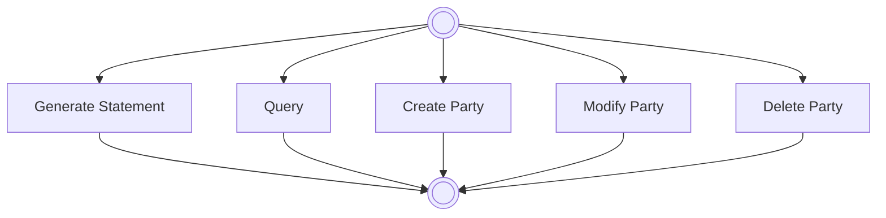

# Party reference data process overview

[src-000368](../../../../../../../../raw-input/target2securities_t2s/ISO20022_MDR_Target2Securities_August_2026_v1.zip) archive member `ISO20022_MDR_Target2Securities_August_2026_v1/Target2-Securities_PartyReferenceData_MessageSet/ISO20022_MDRPart1_Target2Securities_PartyReferenceData_2023_2024_v2.docx`; direct-body paragraph P119; Word-rendered file page 12. Standalone source artwork, additionally checked in Word-rendered file page 12.

[Complete original figure/context](../../../../../../assets/src-000368/originals/image2.png)

## Source reconstruction

## Participants

- [Instructing Party](../../../../../../../../shared/reference/participants/participant-src-000368-instructing-party.md)
- [Executing / Servicing Party](../../../../../../../../shared/reference/participants/participant-src-000368-executing-servicing-party.md)

## Entities and relationships

| Source | Destination | Condition or exchange | Line notation |
| --- | --- | --- | --- |
| top | Generate Statement | Unlabelled connector | --&gt; |
| Generate Statement | bottom | Unlabelled connector | --&gt; |
| top | Query | Unlabelled connector | --&gt; |
| Query | bottom | Unlabelled connector | --&gt; |
| top | Create Party | Unlabelled connector | --&gt; |
| Create Party | bottom | Unlabelled connector | --&gt; |
| top | Modify Party | Unlabelled connector | --&gt; |
| Modify Party | bottom | Unlabelled connector | --&gt; |
| top | Delete Party | Unlabelled connector | --&gt; |
| Delete Party | bottom | Unlabelled connector | --&gt; |

## Qualifications

- P118 explicitly calls this a non-exhaustive high-level scope overview. The shared connector trunks are represented by their five endpoint paths; no mandatory concurrency or order among processes is inferred.
- Both top and bottom source symbols are unlabelled double circles. Their shape is retained without silently converting the top symbol into a solid start point.

## Rendering and visual review

On 2026-11-09 this reconstruction parsed and rendered with Mermaid 12.3.0 / Mermaid browser API + Chromium 156.0.8078.81. The final rendering was directly compared with the complete source for labels, participants, connector endpoints/directions, decisions and line styles. All 47 Word pages were inspected for complete composition. **Visible-source fidelity: pass.** Source conflicts remain open where listed. Mermaid changes layout, actor glyphs, arrowhead styling and final-node centre fill; the original and textual relationship description preserve them.

[Rendered SVG](../../../../../../assets/src-000368/reconstructed-party-reference-data/fig-0002.svg) · [Rendered PNG](../../../../../../assets/src-000368/reconstructed-party-reference-data/fig-0002.png) · [Hash-bound review evidence](../../../../../../../../tracking/reviews/t2s-party-reference-data.json)
