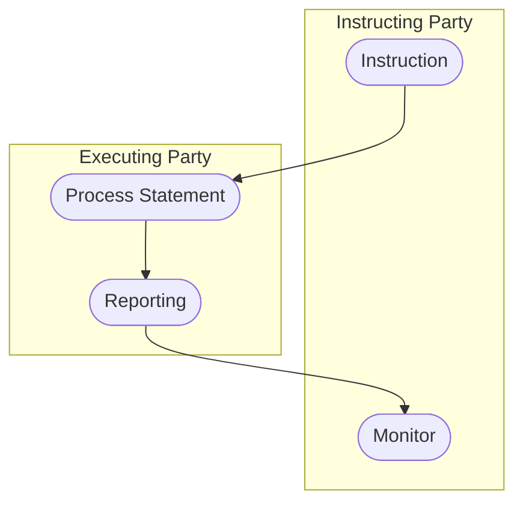

# Party activity statement activity

[src-000368](../../../../../../../../raw-input/target2securities_t2s/ISO20022_MDR_Target2Securities_August_2026_v1.zip) archive member `ISO20022_MDR_Target2Securities_August_2026_v1/Target2-Securities_PartyReferenceData_MessageSet/ISO20022_MDRPart1_Target2Securities_PartyReferenceData_2023_2024_v2.docx`; direct-body paragraph P148; Word-rendered file page 21. Standalone source artwork, additionally checked in Word-rendered file page 21.

[Complete original figure/context](../../../../../../assets/src-000368/derived-previews/image11.emf.png) · [Business flow and conditional narrative](../../flows/flow-src-000368-p128-statement.md)

## Source reconstruction

## Participants

- [Instructing Party](../../../../../../../../shared/reference/participants/participant-src-000368-instructing-party.md)
- [Executing / Servicing Party](../../../../../../../../shared/reference/participants/participant-src-000368-executing-servicing-party.md)
- [Recipient Party](../../../../../../../../shared/reference/participants/participant-src-000368-recipient-party.md)

## Entities and relationships

| Source | Destination | Condition or exchange | Line notation |
| --- | --- | --- | --- |
| Instruction | Process Statement | Unlabelled connector | --&gt; |
| Process Statement | Reporting | Unlabelled connector | --&gt; |
| Reporting | Monitor | Unlabelled connector | --&gt; |

## Qualifications

- No start/final symbols or decision guards are drawn; none are added.
- T18 explicitly excludes the optional instructing-party statement request: no message is created for it. T12 and P297 establish an automatically produced, unsolicited statement under a standing instruction. The drawn Instruction arrow is retained as outside the message scope.
- T12 calls the receiving participant Recipient Party; the diagram and P296 say Instructing Party. Both source labels remain visible without creating a fixed institutional identity.

## Rendering and visual review

On 2026-11-09 this reconstruction parsed and rendered with Mermaid 12.3.0 / Mermaid browser API + Chromium 156.0.8078.81. The final rendering was directly compared with the complete source for labels, participants, connector endpoints/directions, decisions and line styles. All 47 Word pages were inspected for complete composition. **Visible-source fidelity: pass.** Source conflicts remain open where listed. Mermaid changes layout, actor glyphs, arrowhead styling and final-node centre fill; the original and textual relationship description preserve them.

[Rendered SVG](../../../../../../assets/src-000368/reconstructed-party-reference-data/fig-0011.svg) · [Rendered PNG](../../../../../../assets/src-000368/reconstructed-party-reference-data/fig-0011.png) · [Hash-bound review evidence](../../../../../../../../tracking/reviews/t2s-party-reference-data.json)
