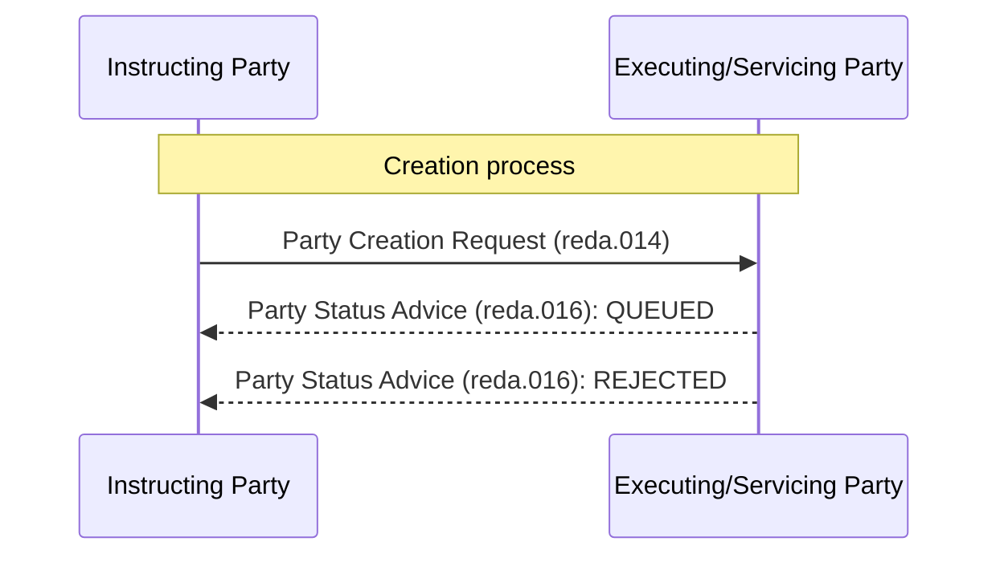

# Creation rejection sequence

[src-000368](../../../../../../../../raw-input/target2securities_t2s/ISO20022_MDR_Target2Securities_August_2026_v1.zip) archive member `ISO20022_MDR_Target2Securities_August_2026_v1/Target2-Securities_PartyReferenceData_MessageSet/ISO20022_MDRPart1_Target2Securities_PartyReferenceData_2023_2024_v2.docx`; direct-body paragraph P167; Word-rendered file page 23. Complete Word-rendered page; figure identified by its heading, actor labels and message sequence. Parent work/docx-render/src-000368/document.pdf; file page 23.

[Complete original figure/context](../../../../../../assets/src-000368/complete-word-figures/fig-0013-word-page-0023.png) · [Business flow and conditional narrative](../../flows/flow-src-000368-p120-create-party.md)

## Source reconstruction

## Participants

- [Instructing Party](../../../../../../../../shared/reference/participants/participant-src-000368-instructing-party.md)
- [Executing / Servicing Party](../../../../../../../../shared/reference/participants/participant-src-000368-executing-servicing-party.md)

## Entities and relationships

| Source | Destination | Condition or exchange | Line notation |
| --- | --- | --- | --- |
| Instructing Party | Executing/Servicing Party | Party Creation Request (reda.014) | -&gt;&gt; |
| Executing/Servicing Party | Instructing Party | Party Status Advice (reda.016): QUEUED | --&gt;&gt; |
| Executing/Servicing Party | Instructing Party | Party Status Advice (reda.016): REJECTED | --&gt;&gt; |

## Qualifications

- Dashed QUEUED and dashed rejection versus solid completion arrows retain source line styles. The narrative makes queuing conditional; the drawing does not require a queue status before every final outcome.
- Initial validation rejection and rejection after dequeuing are separately preserved in the flow narrative; multiple rejection reasons may be reported.
- The complete Word page is retained because the diagram uses native Word objects and reused pictograms, or the standalone EMF preview is clipped. Individual embedded assets remain unchanged but are not treated as complete figures.

## Rendering and visual review

On 2026-11-09 this reconstruction parsed and rendered with Mermaid 12.3.0 / Mermaid browser API + Chromium 156.0.8078.81. The final rendering was directly compared with the complete source for labels, participants, connector endpoints/directions, decisions and line styles. All 47 Word pages were inspected for complete composition. **Visible-source fidelity: pass.** Source conflicts remain open where listed. Mermaid changes layout, actor glyphs, arrowhead styling and final-node centre fill; the original and textual relationship description preserve them.

[Rendered SVG](../../../../../../assets/src-000368/reconstructed-party-reference-data/fig-0013.svg) · [Rendered PNG](../../../../../../assets/src-000368/reconstructed-party-reference-data/fig-0013.png) · [Hash-bound review evidence](../../../../../../../../tracking/reviews/t2s-party-reference-data.json)
