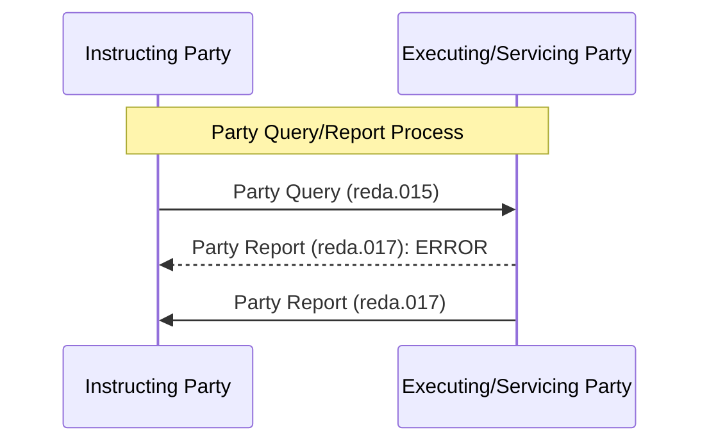

# Party query and report sequence

[src-000368](../../../../../../../../raw-input/target2securities_t2s/ISO20022_MDR_Target2Securities_August_2026_v1.zip) archive member `ISO20022_MDR_Target2Securities_August_2026_v1/Target2-Securities_PartyReferenceData_MessageSet/ISO20022_MDRPart1_Target2Securities_PartyReferenceData_2023_2024_v2.docx`; direct-body paragraph P273; Word-rendered file page 29. Complete Word-rendered page; figure identified by its heading, actor labels and message sequence. Parent work/docx-render/src-000368/document.pdf; file page 29.

[Complete original figure/context](../../../../../../assets/src-000368/complete-word-figures/fig-0018-word-page-0029.png) · [Business flow and conditional narrative](../../flows/flow-src-000368-p126-query.md)

## Source reconstruction

## Participants

- [Instructing Party](../../../../../../../../shared/reference/participants/participant-src-000368-instructing-party.md)
- [Executing / Servicing Party](../../../../../../../../shared/reference/participants/participant-src-000368-executing-servicing-party.md)

## Entities and relationships

| Source | Destination | Condition or exchange | Line notation |
| --- | --- | --- | --- |
| Instructing Party | Executing/Servicing Party | Party Query (reda.015) | -&gt;&gt; |
| Executing/Servicing Party | Instructing Party | Party Report (reda.017): ERROR | --&gt;&gt; |
| Executing/Servicing Party | Instructing Party | Party Report (reda.017) | -&gt;&gt; |

## Qualifications

- The source draws both error and normal response without alternative frames. P278/P288 and P280/P290 distinguish those outcomes; both returns are not interpreted as always occurring.
- Error conditions include excessive processing time, wrong combination of criteria or no result set. A query result timestamp records when selection was performed (P100/P103).
- The complete Word page is retained because the diagram uses native Word objects and reused pictograms, or the standalone EMF preview is clipped. Individual embedded assets remain unchanged but are not treated as complete figures.

## Rendering and visual review

On 2026-11-09 this reconstruction parsed and rendered with Mermaid 12.3.0 / Mermaid browser API + Chromium 156.0.8078.81. The final rendering was directly compared with the complete source for labels, participants, connector endpoints/directions, decisions and line styles. All 47 Word pages were inspected for complete composition. **Visible-source fidelity: pass.** Source conflicts remain open where listed. Mermaid changes layout, actor glyphs, arrowhead styling and final-node centre fill; the original and textual relationship description preserve them.

[Rendered SVG](../../../../../../assets/src-000368/reconstructed-party-reference-data/fig-0018.svg) · [Rendered PNG](../../../../../../assets/src-000368/reconstructed-party-reference-data/fig-0018.png) · [Hash-bound review evidence](../../../../../../../../tracking/reviews/t2s-party-reference-data.json)
