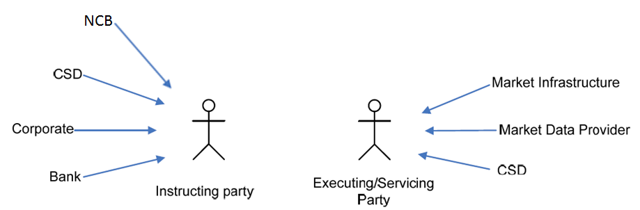

# fig-0001 - original figure evidence

Source: [src-000368](../../../../../../../../../raw-input/target2securities_t2s/ISO20022_MDR_Target2Securities_August_2026_v1.zip) archive member `ISO20022_MDR_Target2Securities_August_2026_v1/Target2-Securities_PartyReferenceData_MessageSet/ISO20022_MDRPart1_Target2Securities_PartyReferenceData_2023_2024_v2.docx`. Locator: direct-body paragraph P111; BusinessRoles and Participants; /w:document/w:body/w:p[111].

Original extracted asset: [image1.png](../../../../../../../assets/src-000368/originals/image1.png)

## Canonical reconstruction and review

[Canonical diagram, source qualifications, participant/flow links and recorded review evidence](../../../diagrams/party-reference-data/fig-0001.md). Original media and this occurrence's precise locator are retained. Rendering and visual comparison results above are copied from the canonical reference; any unresolved business, version or contextual limitation remains open.

<!-- PARTY-DIAGRAM -->
[Canonical complete reconstruction and review evidence](../../../diagrams/party-reference-data/fig-0001.md)
