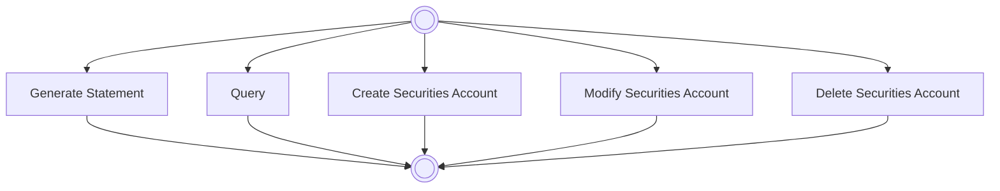

# Securities account process scope

[src-000371](../../../../../../../../raw-input/target2securities_t2s/ISO20022_MDR_Target2Securities_August_2026_v1.zip) archive member `ISO20022_MDR_Target2Securities_August_2026_v1/Target2-Securities_SecuritiesAccountReferenceData_MessageSet/ISO20022_MDRPart1_Target2Securities_SecuritiesAccountReferenceData_v2.docx`; direct-body paragraph P151; Word-rendered file page13.

[Complete Word-composed source figure](../../../../../../assets/src-000371/complete-word-figures/fig-0002-word-page-0013.png)

## Source reconstruction

## Participants

- [Instructing Party](../../../../../../../../shared/reference/participants/participant-src-000371-instructing-party.md)
- [Executing/Servicing Party](../../../../../../../../shared/reference/participants/participant-src-000371-executing-servicing-party.md)

## Entities and relationships

| Source | Destination | Condition or exchange | Line notation |
| --- | --- | --- | --- |
| top | Generate Statement | Unlabelled connector | --&gt; |
| Generate Statement | bottom | Unlabelled connector | --&gt; |
| top | Query | Unlabelled connector | --&gt; |
| Query | bottom | Unlabelled connector | --&gt; |
| top | Create Securities Account | Unlabelled connector | --&gt; |
| Create Securities Account | bottom | Unlabelled connector | --&gt; |
| top | Modify Securities Account | Unlabelled connector | --&gt; |
| Modify Securities Account | bottom | Unlabelled connector | --&gt; |
| top | Delete Securities Account | Unlabelled connector | --&gt; |
| Delete Securities Account | bottom | Unlabelled connector | --&gt; |

## Qualifications

- P149 explicitly calls this non-exhaustive. Both source terminators are unlabelled double circles; shared trunks are represented by their five endpoint paths without inferring mandatory concurrency.

## Rendering and visual review

All labels, roles, endpoints, directions, line styles, decision guards and complete Word composition were directly compared with this final Mermaid12.3.0 rendering on 2026-11-09. All42 complete Word pages were inventoried. Native text supporting clipped labels is explicitly distinguished from visible artwork; source conflicts remain open where listed. Mermaid changes layout, actor pictograms and final-node centre fill; original artwork and textual descriptions retain those features.

[Rendered SVG](../../../../../../assets/src-000371/reconstructed-securities-account-reference-data/fig-0002.svg) · [Rendered PNG](../../../../../../assets/src-000371/reconstructed-securities-account-reference-data/fig-0002.png) · [Hash-bound review evidence](../../../../../../../../tracking/reviews/t2s-securities-account-reference-data.json)
