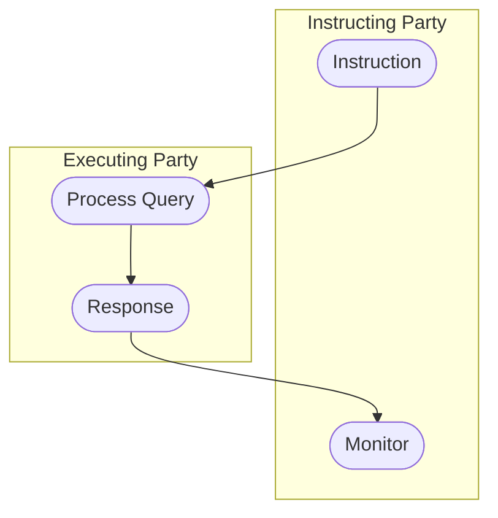

# Query and response activity

[src-000371](../../../../../../../../raw-input/target2securities_t2s/ISO20022_MDR_Target2Securities_August_2026_v1.zip) archive member `ISO20022_MDR_Target2Securities_August_2026_v1/Target2-Securities_SecuritiesAccountReferenceData_MessageSet/ISO20022_MDRPart1_Target2Securities_SecuritiesAccountReferenceData_v2.docx`; direct-body paragraph P170; Word-rendered file page20.

[Complete Word-composed source figure](../../../../../../assets/src-000371/complete-word-figures/fig-0010-word-page-0020.png) · [Business flow and conditional narrative](../../flows/flow-src-000371-p156-query.md)

## Source reconstruction

## Participants

- [Instructing Party](../../../../../../../../shared/reference/participants/participant-src-000371-instructing-party.md)
- [Executing/Servicing Party](../../../../../../../../shared/reference/participants/participant-src-000371-executing-servicing-party.md)

## Entities and relationships

| Source | Destination | Condition or exchange | Line notation |
| --- | --- | --- | --- |
| Instruction | Process Query | Unlabelled connector | --&gt; |
| Process Query | Response | Unlabelled connector | --&gt; |
| Response | Monitor | Unlabelled connector | --&gt; |

## Qualifications

- No source start/end symbols or guards are added.

## Rendering and visual review

All labels, roles, endpoints, directions, line styles, decision guards and complete Word composition were directly compared with this final Mermaid12.3.0 rendering on 2026-11-09. All42 complete Word pages were inventoried. Native text supporting clipped labels is explicitly distinguished from visible artwork; source conflicts remain open where listed. Mermaid changes layout, actor pictograms and final-node centre fill; original artwork and textual descriptions retain those features.

[Rendered SVG](../../../../../../assets/src-000371/reconstructed-securities-account-reference-data/fig-0010.svg) · [Rendered PNG](../../../../../../assets/src-000371/reconstructed-securities-account-reference-data/fig-0010.png) · [Hash-bound review evidence](../../../../../../../../tracking/reviews/t2s-securities-account-reference-data.json)
