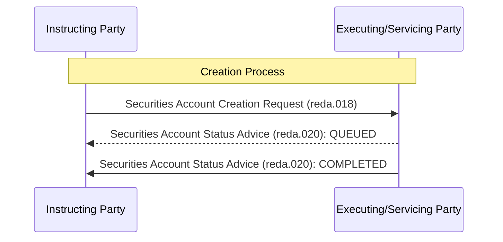

# Creation confirmation sequence

[src-000371](../../../../../../../../raw-input/target2securities_t2s/ISO20022_MDR_Target2Securities_August_2026_v1.zip) archive member `ISO20022_MDR_Target2Securities_August_2026_v1/Target2-Securities_SecuritiesAccountReferenceData_MessageSet/ISO20022_MDRPart1_Target2Securities_SecuritiesAccountReferenceData_v2.docx`; direct-body paragraph P181; Word-rendered file page23.

[Complete Word-composed source figure](../../../../../../assets/src-000371/complete-word-figures/fig-0012-word-page-0023.png) · [Business flow and conditional narrative](../../flows/flow-src-000371-p152-create-securities-account.md)

## Source reconstruction

## Participants

- [Instructing Party](../../../../../../../../shared/reference/participants/participant-src-000371-instructing-party.md)
- [Executing/Servicing Party](../../../../../../../../shared/reference/participants/participant-src-000371-executing-servicing-party.md)

## Entities and relationships

| Source | Destination | Condition or exchange | Line notation |
| --- | --- | --- | --- |
| Instructing Party | Executing/Servicing Party | Securities Account Creation Request (reda.018) | -&gt;&gt; |
| Executing/Servicing Party | Instructing Party | Securities Account Status Advice (reda.020): QUEUED | --&gt;&gt; |
| Executing/Servicing Party | Instructing Party | Securities Account Status Advice (reda.020): COMPLETED | -&gt;&gt; |

## Qualifications

- The source uses a dashed QUEUED return and solid final return, including rejection. Conditional queuing and initial-versus-post-queue rejection reasons remain in the narrative.
- Multiple rejection reasons may be reported. The picture does not make QUEUED mandatory for every final response.
- The request code suffix is not visible in the local Word page but is preserved in native drawing text at P181. The native text also contains an extra COMPLETED token; no extra connector or outcome is inferred.

## Rendering and visual review

All labels, roles, endpoints, directions, line styles, decision guards and complete Word composition were directly compared with this final Mermaid12.3.0 rendering on 2026-11-09. All42 complete Word pages were inventoried. Native text supporting clipped labels is explicitly distinguished from visible artwork; source conflicts remain open where listed. Mermaid changes layout, actor pictograms and final-node centre fill; original artwork and textual descriptions retain those features.

[Rendered SVG](../../../../../../assets/src-000371/reconstructed-securities-account-reference-data/fig-0012.svg) · [Rendered PNG](../../../../../../assets/src-000371/reconstructed-securities-account-reference-data/fig-0012.png) · [Hash-bound review evidence](../../../../../../../../tracking/reviews/t2s-securities-account-reference-data.json)
