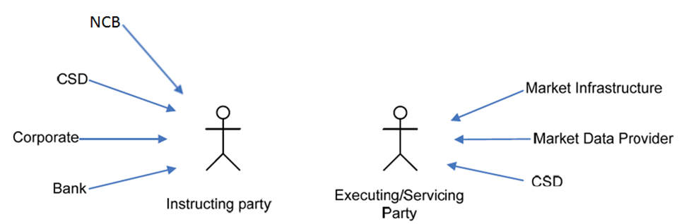

# fig-0001 - original figure evidence

Source: [src-000371](../../../../../../../../../raw-input/target2securities_t2s/ISO20022_MDR_Target2Securities_August_2026_v1.zip) archive member `ISO20022_MDR_Target2Securities_August_2026_v1/Target2-Securities_SecuritiesAccountReferenceData_MessageSet/ISO20022_MDRPart1_Target2Securities_SecuritiesAccountReferenceData_v2.docx`. Locator: direct-body paragraph P143; BusinessRoles and Participants; /w:document/w:body/w:p[143].

Original extracted asset: [image1.png](../../../../../../../assets/src-000371/originals/image1.png)

## Canonical reconstruction

The complete Word composition and final reconstruction were directly compared. [Canonical diagram, source limitations and review evidence](../../../diagrams/securities-account-reference-data/fig-0001.md)

<!-- SECACCOUNT-DIAGRAM -->
[Canonical complete source reconstruction](../../../diagrams/securities-account-reference-data/fig-0001.md)
