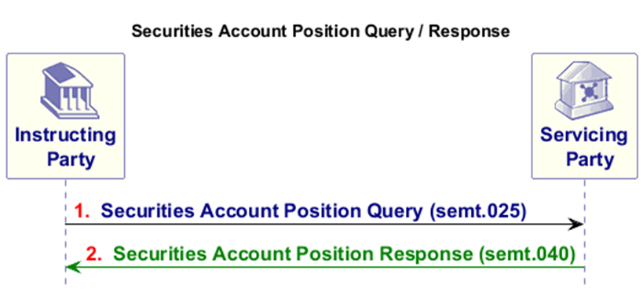
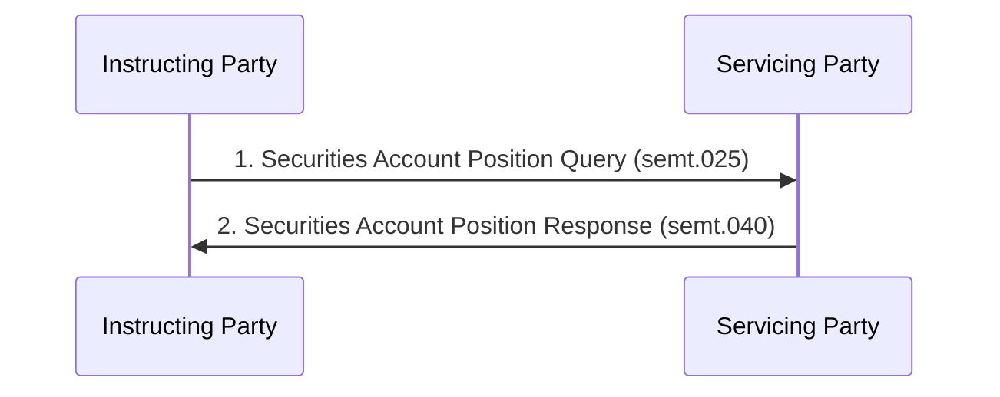

# Securities account position query and response exchange

## Source evidence

[src-000374](../../../../../../../../raw-input/target2securities_t2s/ISO20022_MDR_Target2Securities_August_2026_v1.zip) archive member `ISO20022_MDR_Target2Securities_August_2026_v1/Target2-Securities_SecuritiesAndPenaltyReporting_MessageSet/ISO20022_MDRPart1_Target2Securities_SecuritiesAndPenaltyReporting_v2.docx`; Scope and Functionality / Scope / Securities Account Position Query and Securities Account Position Response; direct-body paragraph P55; word/media/image1.png. [Unchanged original figure](../../../../../../assets/src-000374/originals/image1.png).

## Mermaid reconstruction

## Roles, activities and alternatives

A CSD or directly connected party sends criteria and an optional date range to T2S acting as Servicing Party. The response covers matching positions across the accounts and securities selected. Complete Word6 displays this image only: embedded legacy actor fragments/text in the same paragraph do not create extra visible actors or a second response. P258 adds the error-family sese.022, absent from this success-only picture; its exact version is not specified here.

| Source-scoped role | Canonical reference |
| --- | --- |
| instructing party | [instructing party](../../../../../../../../shared/reference/participants/participant-src-000374-instructing-party.md) |
| executing servicing party | [executing servicing party](../../../../../../../../shared/reference/participants/participant-src-000374-executing-servicing-party.md) |
| servicing party | [servicing party](../../../../../../../../shared/reference/participants/participant-src-000374-servicing-party.md) |
| central securities depositories csd | [central securities depositories csd](../../../../../../../../shared/reference/participants/participant-src-000374-central-securities-depositories-csd.md) |
| direct connected participant dcp | [direct connected participant dcp](../../../../../../../../shared/reference/participants/participant-src-000374-direct-connected-participant-dcp.md) |
| account owner | [account owner](../../../../../../../../shared/reference/participants/participant-src-000374-account-owner.md) |
| account servicer | [account servicer](../../../../../../../../shared/reference/participants/participant-src-000374-account-servicer.md) |
| authorised party | [authorised party](../../../../../../../../shared/reference/participants/participant-src-000374-authorised-party.md) |
| t2s actor | [t2s actor](../../../../../../../../shared/reference/participants/participant-src-000374-t2s-actor.md) |

Source responsibilities/conditions: [T8](../../documents/src-000374/tables/tbl-0008.md), [T10](../../documents/src-000374/tables/tbl-0010.md).

## Exact message evidence

| Source family | Exact supplied definition | Companion MDR Part2 locator |
| --- | --- | --- |
| semt.025 | [semt.025.001.01](../../../../../messages/semt.025.001.01/index.md) | src-000375; 2 semt.025.001.01 SecuritiesAccountPositionQueryV01; file pages5-12 |
| semt.040 | [semt.040.001.01](../../../../../messages/semt.040.001.01/index.md) | src-000375; 5 semt.040.001.01 SecuritiesAccountPositionResponseV01; file pages166-178 |

Reusable flows: [Securities Account Position Query and Securities Account Position Response](../../flows/flow-src-000374-p232-securities-account-position-query-and-securities-account-position-resp.md).

## Review evidence

Compared complete source pages and rendered reconstruction for actor labels/stereotypes, lanes, message order/direction, all choice labels, optional/error outcomes, black join bar and green reporting context. No query request is invented for the scheduled penalty-report activity; exact missing error-family versions remain explicit. Rendering and visual comparison passed2026-11-09 Europe/Warsaw. [Compared Mermaid12.3.0 rendering](../../../../../../assets/src-000374/reconstructed/fig-0001.png). Source: [Word6](../../../../../../assets/src-000374/source-page-renders/word-page-06.png).

Source scope colors: the return response/report is green; the original palette remains in the original image, while native sequence rendering uses its standard monochrome arrows. No meaning is changed or inferred from an additional color.

Two source canvases anchored outside Word6 were recovered separately: [legacy custody-report exchange](fig-0014.md). They are not merged with this current response definition.
