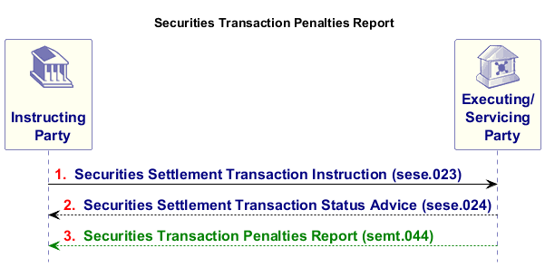
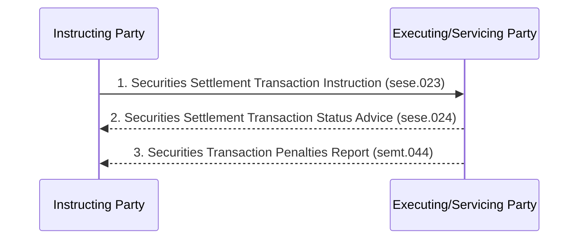

# Penalty reporting in settlement instruction context

## Source evidence

[src-000374](../../../../../../../../raw-input/target2securities_t2s/ISO20022_MDR_Target2Securities_August_2026_v1.zip) archive member `ISO20022_MDR_Target2Securities_August_2026_v1/Target2-Securities_SecuritiesAndPenaltyReporting_MessageSet/ISO20022_MDRPart1_Target2Securities_SecuritiesAndPenaltyReporting_v2.docx`; Scope and Functionality / Scope / Securities Transaction Penalties Report; direct-body paragraph P79; word/media/image5.png. [Unchanged original figure](../../../../../../assets/src-000374/originals/image5.png).

## Mermaid reconstruction

## Roles, activities and alternatives

The first instruction and returning status advice are surrounding context; only semt.044 is the green in-scope report. Cash penalties are computed daily for instructions unsettled after their intended settlement date and can be modified by a CSD or recalculated after reference-data changes. The picture retains the solid instruction and dashed returning status/report directions. The report is system-triggered (T8/T12), so the three arrows do not require one immediate penalty report for every instruction. Source sese.023/sese.024 family labels are retained without choosing an exact definition from another edition.

| Source-scoped role | Canonical reference |
| --- | --- |
| instructing party | [instructing party](../../../../../../../../shared/reference/participants/participant-src-000374-instructing-party.md) |
| executing servicing party | [executing servicing party](../../../../../../../../shared/reference/participants/participant-src-000374-executing-servicing-party.md) |
| servicing party | [servicing party](../../../../../../../../shared/reference/participants/participant-src-000374-servicing-party.md) |
| settlement infrastructure | [settlement infrastructure](../../../../../../../../shared/reference/participants/participant-src-000374-settlement-infrastructure.md) |
| central securities depositories csd | [central securities depositories csd](../../../../../../../../shared/reference/participants/participant-src-000374-central-securities-depositories-csd.md) |
| csd participant | [csd participant](../../../../../../../../shared/reference/participants/participant-src-000374-csd-participant.md) |
| external csd | [external csd](../../../../../../../../shared/reference/participants/participant-src-000374-external-csd.md) |
| account servicer | [account servicer](../../../../../../../../shared/reference/participants/participant-src-000374-account-servicer.md) |
| penalty debtor | [penalty debtor](../../../../../../../../shared/reference/participants/participant-src-000374-penalty-debtor.md) |
| penalty creditor | [penalty creditor](../../../../../../../../shared/reference/participants/participant-src-000374-penalty-creditor.md) |
| t2s actor | [t2s actor](../../../../../../../../shared/reference/participants/participant-src-000374-t2s-actor.md) |

Source responsibilities/conditions: [T8](../../documents/src-000374/tables/tbl-0008.md), [T12](../../documents/src-000374/tables/tbl-0012.md).

## Exact message evidence

| Source family | Exact supplied definition | Companion MDR Part2 locator |
| --- | --- | --- |
| semt.044 | [semt.044.001.01](../../../../../messages/semt.044.001.01/index.md) | src-000375; 6 semt.044.001.01 SecuritiesTransactionPenaltiesReportV01; file pages179-245 |

Reusable flows: [Securities Transaction Penalties Report](../../flows/flow-src-000374-p243-securities-transaction-penalties-report.md).

## Review evidence

Compared complete source pages and rendered reconstruction for actor labels/stereotypes, lanes, message order/direction, all choice labels, optional/error outcomes, black join bar and green reporting context. No query request is invented for the scheduled penalty-report activity; exact missing error-family versions remain explicit. Rendering and visual comparison passed2026-11-09 Europe/Warsaw. [Compared Mermaid12.3.0 rendering](../../../../../../assets/src-000374/reconstructed/fig-0003.png). Source: [Word8](../../../../../../assets/src-000374/source-page-renders/word-page-08.png).

Source scope colors: the return response/report is green; the original palette remains in the original image, while native sequence rendering uses its standard monochrome arrows. No meaning is changed or inferred from an additional color.
