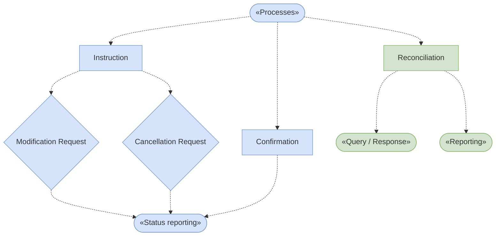

# Reporting process hierarchy detail

[Actor-context parent](fig-0004.md); [Complete unchanged original](../../../../../../assets/src-000374/originals/image6.png).

This detail preserves the lower source hierarchy, all dashed arrow directions and green Reconciliation/Query-Response/Reporting scope. Modification and Cancellation Request diamonds are source process labels; they are not asserted to form an exclusive choice. Native actor notation is preserved in the parent view.

## Actual review evidence

Compared all source labels, endpoints, direction and shapes with [Mermaid12.3.0 reconstruction](../../../../../../assets/src-000374/reconstructed/fig-0004-processes.png) on2026-11-09. All nine lower process nodes and ten directed dashed connectors compared with source Word14, retaining rectangles, request diamonds and process ellipses in native flowchart form.
