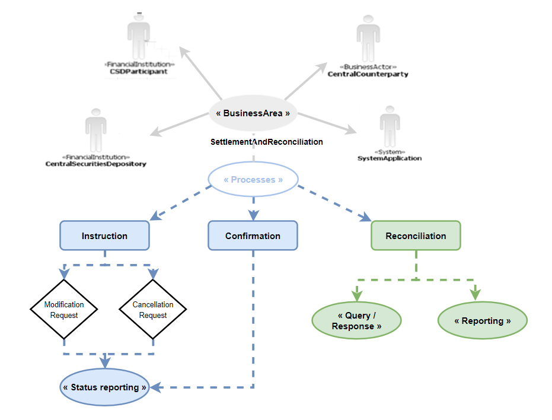

# Securities reporting actors and process context

## Source evidence

[src-000374](../../../../../../../../raw-input/target2securities_t2s/ISO20022_MDR_Target2Securities_August_2026_v1.zip) archive member `ISO20022_MDR_Target2Securities_August_2026_v1/Target2-Securities_SecuritiesAndPenaltyReporting_MessageSet/ISO20022_MDRPart1_Target2Securities_SecuritiesAndPenaltyReporting_v2.docx`; BusinessRoles and Participants; direct-body paragraph P204; word/media/image6.png. [Unchanged original figure](../../../../../../assets/src-000374/originals/image6.png).



## Mermaid reconstruction

```mermaid
usecase-beta
 direction TB
 actor CP("«FinancialInstitution» CSDParticipant")
 actor CSD("«FinancialInstitution» CentralSecuritiesDepository")
 actor CCP("«BusinessActor» CentralCounterparty")
 actor SYS("«System» SystemApplication")
 BA("«BusinessArea» SettlementAndReconciliation")
 P("«Processes»")
 BA --> CP
 BA --> CSD
 BA --> CCP
 BA --> SYS
 BA -- P
```

## Roles, activities and alternatives

Native use-case notation preserves four actor symbols, their stereotypes, the directed business-area-to-actor links and the plain business-area/process link. The lower process hierarchy is reconstructed in the linked detail view, preserving its rectangles, diamonds, ellipses, dashed arrows and green reporting scope. No include/extend or inheritance semantics are inferred. P205 explicitly identifies only green reporting processes as scope; surrounding instruction, cancellation, modification and confirmation processes are context.

| Source-scoped role | Canonical reference |
| --- | --- |
| csd participant | [csd participant](../../../../../../../../shared/reference/participants/participant-src-000374-csd-participant.md) |
| central securities depositories csd | [central securities depositories csd](../../../../../../../../shared/reference/participants/participant-src-000374-central-securities-depositories-csd.md) |
| central counterparty | [central counterparty](../../../../../../../../shared/reference/participants/participant-src-000374-central-counterparty.md) |
| system application | [system application](../../../../../../../../shared/reference/participants/participant-src-000374-system-application.md) |
| t2s operator | [t2s operator](../../../../../../../../shared/reference/participants/participant-src-000374-t2s-operator.md) |
| national central bank | [national central bank](../../../../../../../../shared/reference/participants/participant-src-000374-national-central-bank.md) |


Source responsibilities/conditions: [T6](../../documents/src-000374/tables/tbl-0006.md), [T7](../../documents/src-000374/tables/tbl-0007.md), [T8](../../documents/src-000374/tables/tbl-0008.md).

## Exact message evidence

| Source family | Exact supplied definition | Companion MDR Part2 locator |
| --- | --- | --- |
| semt.025 | [semt.025.001.01](../../../../../messages/semt.025.001.01/index.md) | src-000375; 2 semt.025.001.01 SecuritiesAccountPositionQueryV01; file pages5-12 |
| semt.026 | [semt.026.001.01](../../../../../messages/semt.026.001.01/index.md) | src-000375; 3 semt.026.001.01 SecuritiesSettlementTransactionQueryV01; file pages13-76 |
| semt.027 | [semt.027.001.01](../../../../../messages/semt.027.001.01/index.md) | src-000375; 4 semt.027.001.01 SecuritiesSettlementTransactionQueryResponseV01; file pages77-165 |
| semt.040 | [semt.040.001.01](../../../../../messages/semt.040.001.01/index.md) | src-000375; 5 semt.040.001.01 SecuritiesAccountPositionResponseV01; file pages166-178 |
| semt.044 | [semt.044.001.01](../../../../../messages/semt.044.001.01/index.md) | src-000375; 6 semt.044.001.01 SecuritiesTransactionPenaltiesReportV01; file pages179-245 |


Reusable flows: [Query Report Process](../../flows/flow-src-000374-p224-query-report-process.md).

## Review evidence

Compared complete source pages and rendered reconstruction for actor labels/stereotypes, lanes, message order/direction, all choice labels, optional/error outcomes, black join bar and green reporting context. No query request is invented for the scheduled penalty-report activity; exact missing error-family versions remain explicit. Rendering and visual comparison passed2026-11-09 Europe/Warsaw. [Compared Mermaid12.3.0 rendering](../../../../../../assets/src-000374/reconstructed/fig-0004.png). Source: [Word14](../../../../../../assets/src-000374/source-page-renders/word-page-14.png).

Complete lower hierarchy: [process detail](fig-0004-processes.md).
