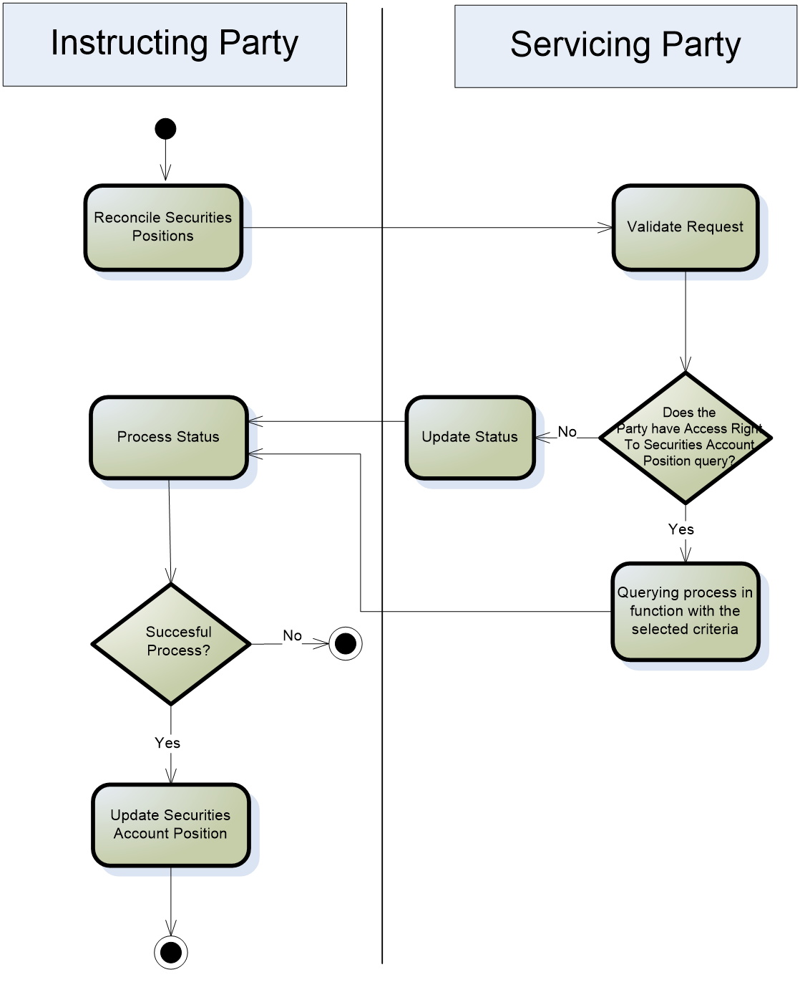
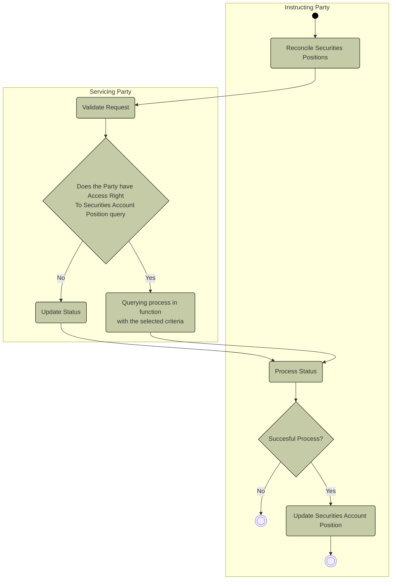

# Securities position query activity with access and error decisions

## Source evidence

[src-000374](../../../../../../../../raw-input/target2securities_t2s/ISO20022_MDR_Target2Securities_August_2026_v1.zip) archive member `ISO20022_MDR_Target2Securities_August_2026_v1/Target2-Securities_SecuritiesAndPenaltyReporting_MessageSet/ISO20022_MDRPart1_Target2Securities_SecuritiesAndPenaltyReporting_v2.docx`; Description of BusinessActivities / Securities Account Position Query and Securities Account Position Response; direct-body paragraph P234; word/media/image12.emf. [Unchanged original figure](../../../../../../assets/src-000374/originals/image12.emf).

## Mermaid reconstruction

## Roles, activities and alternatives

The Instructing Party initiates reconciliation by querying securities positions. Servicing Party validates access and the technical/business request: an unsuccessful check updates status and sends an error; a valid query retrieves matching data. Both return to Process Status. The Instructing Party ends on failure or updates its position reconciliation on success. T10 defines the update as an external reconciliation process, not a platform ownership transfer or settlement instruction. P258 names sese.022 for error and requires account or account owner for history queries.

| Source-scoped role | Canonical reference |
| --- | --- |
| instructing party | [instructing party](../../../../../../../../shared/reference/participants/participant-src-000374-instructing-party.md) |
| executing servicing party | [executing servicing party](../../../../../../../../shared/reference/participants/participant-src-000374-executing-servicing-party.md) |
| servicing party | [servicing party](../../../../../../../../shared/reference/participants/participant-src-000374-servicing-party.md) |
| account owner | [account owner](../../../../../../../../shared/reference/participants/participant-src-000374-account-owner.md) |
| account servicer | [account servicer](../../../../../../../../shared/reference/participants/participant-src-000374-account-servicer.md) |
| authorised party | [authorised party](../../../../../../../../shared/reference/participants/participant-src-000374-authorised-party.md) |
| central securities depositories csd | [central securities depositories csd](../../../../../../../../shared/reference/participants/participant-src-000374-central-securities-depositories-csd.md) |
| direct connected participant dcp | [direct connected participant dcp](../../../../../../../../shared/reference/participants/participant-src-000374-direct-connected-participant-dcp.md) |
| t2s actor | [t2s actor](../../../../../../../../shared/reference/participants/participant-src-000374-t2s-actor.md) |

Source responsibilities/conditions: [T8](../../documents/src-000374/tables/tbl-0008.md), [T10](../../documents/src-000374/tables/tbl-0010.md).

## Exact message evidence

| Source family | Exact supplied definition | Companion MDR Part2 locator |
| --- | --- | --- |
| semt.025 | [semt.025.001.01](../../../../../messages/semt.025.001.01/index.md) | src-000375; 2 semt.025.001.01 SecuritiesAccountPositionQueryV01; file pages5-12 |
| semt.040 | [semt.040.001.01](../../../../../messages/semt.040.001.01/index.md) | src-000375; 5 semt.040.001.01 SecuritiesAccountPositionResponseV01; file pages166-178 |

Reusable flows: [Securities Account Position Query and Securities Account Position Response](../../flows/flow-src-000374-p232-securities-account-position-query-and-securities-account-position-resp.md).

## Review evidence

Compared complete source pages and rendered reconstruction for actor labels/stereotypes, lanes, message order/direction, all choice labels, optional/error outcomes, black join bar and green reporting context. No query request is invented for the scheduled penalty-report activity; exact missing error-family versions remain explicit. Rendering and visual comparison passed2026-11-09 Europe/Warsaw. [Compared Mermaid12.3.0 rendering](../../../../../../assets/src-000374/reconstructed/fig-0010.png). Source: [Word19](../../../../../../assets/src-000374/source-page-renders/word-page-19.png).
