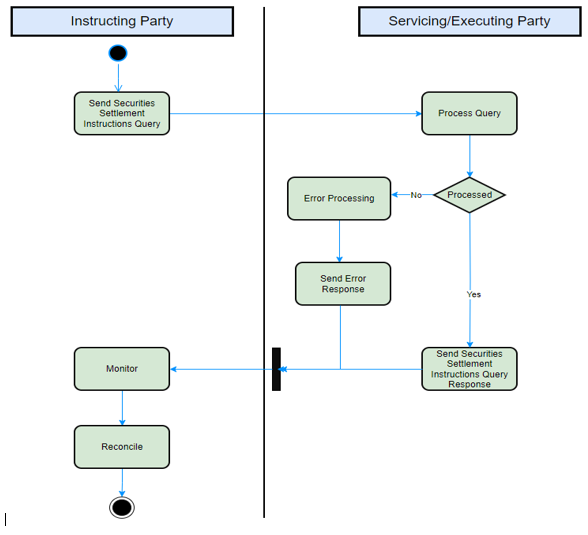
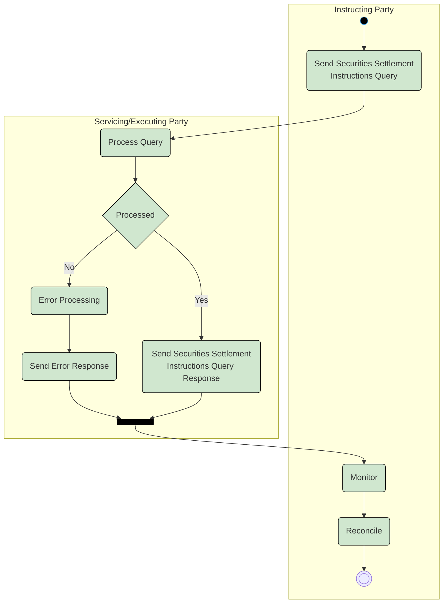

# Securities settlement query activity and operational-error branch

## Source evidence

[src-000374](../../../../../../../../raw-input/target2securities_t2s/ISO20022_MDR_Target2Securities_August_2026_v1.zip) archive member `ISO20022_MDR_Target2Securities_August_2026_v1/Target2-Securities_SecuritiesAndPenaltyReporting_MessageSet/ISO20022_MDRPart1_Target2Securities_SecuritiesAndPenaltyReporting_v2.docx`; Description of BusinessActivities / Securities Account Position Query and Securities Account Position Response / Securities Settlement Transaction Query and Securities Settlement Transaction Query Response; direct-body paragraph P240; word/media/image13.png. [Unchanged original figure](../../../../../../assets/src-000374/originals/image13.png).

## Mermaid reconstruction

## Roles, activities and alternatives

The query initiator requests instructions matching its criteria. Executing/Servicing Party validates the query. The No branch adds operational error details and sends an error response; Yes sends the requested instruction response. Both source arrows join at the black bar and return to Monitor, then Reconcile. The preceding Yes/No decision is exclusive; the bar is retained without inventing parallel execution. The original vertical bar appears horizontally in this top-down native layout. T11 and P266 identify the error alternative; the exact sese.022 definition is unspecified.

| Source-scoped role | Canonical reference |
| --- | --- |
| instructing party | [instructing party](../../../../../../../../shared/reference/participants/participant-src-000374-instructing-party.md) |
| executing servicing party | [executing servicing party](../../../../../../../../shared/reference/participants/participant-src-000374-executing-servicing-party.md) |
| central securities depositories csd | [central securities depositories csd](../../../../../../../../shared/reference/participants/participant-src-000374-central-securities-depositories-csd.md) |
| direct connected participant dcp | [direct connected participant dcp](../../../../../../../../shared/reference/participants/participant-src-000374-direct-connected-participant-dcp.md) |
| payment bank | [payment bank](../../../../../../../../shared/reference/participants/participant-src-000374-payment-bank.md) |
| settlement bank | [settlement bank](../../../../../../../../shared/reference/participants/participant-src-000374-settlement-bank.md) |

Source responsibilities/conditions: [T8](../../documents/src-000374/tables/tbl-0008.md), [T11](../../documents/src-000374/tables/tbl-0011.md).

## Exact message evidence

| Source family | Exact supplied definition | Companion MDR Part2 locator |
| --- | --- | --- |
| semt.026 | [semt.026.001.01](../../../../../messages/semt.026.001.01/index.md) | src-000375; 3 semt.026.001.01 SecuritiesSettlementTransactionQueryV01; file pages13-76 |
| semt.027 | [semt.027.001.01](../../../../../messages/semt.027.001.01/index.md) | src-000375; 4 semt.027.001.01 SecuritiesSettlementTransactionQueryResponseV01; file pages77-165 |

Reusable flows: [Securities Settlement Transaction Query and Securities Settlement Transaction Query Response](../../flows/flow-src-000374-p239-securities-settlement-transaction-query-and-securities-settlement-tran.md).

## Review evidence

Compared complete source pages and rendered reconstruction for actor labels/stereotypes, lanes, message order/direction, all choice labels, optional/error outcomes, black join bar and green reporting context. No query request is invented for the scheduled penalty-report activity; exact missing error-family versions remain explicit. Rendering and visual comparison passed2026-11-09 Europe/Warsaw. [Compared Mermaid12.3.0 rendering](../../../../../../assets/src-000374/reconstructed/fig-0011.png). Source: [Word21](../../../../../../assets/src-000374/source-page-renders/word-page-21.png).
