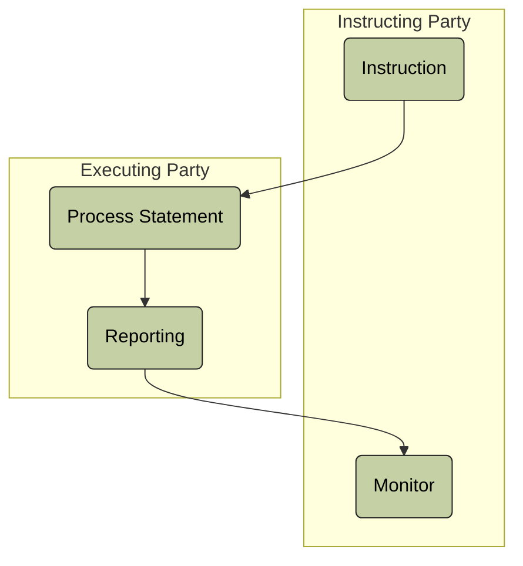

# Security activity statement production

[src-000377](../../../../../../../../raw-input/target2securities_t2s/ISO20022_MDR_Target2Securities_August_2026_v1.zip) archive member `ISO20022_MDR_Target2Securities_August_2026_v1/Target2-Securities_SecuritiesReferenceData_MessageSet/ISO20022_MDRPart1_Target2Securities_SecuritiesReferenceData_v2.docx`; direct-body paragraph P166; Description of BusinessActivities / Statement Process; rendered Word file page 20.

[Complete source figure / composite](../../../../../../assets/src-000377/originals/image11.png) · [Whole Word-page context](../../../../../../assets/src-000377/word-page-context/page-0020.png)

## Mermaid reconstruction

## Participants and responsibilities

- [Instructing Party](../../../../../../../../shared/reference/participants/participant-src-000377-instructing-party.md)
- [Executing Party](../../../../../../../../shared/reference/participants/participant-src-000377-executing-party.md)
- [Executing/Servicing Party](../../../../../../../../shared/reference/participants/participant-src-000377-executing-servicing-party.md)
- [Recipient Party](../../../../../../../../shared/reference/participants/participant-src-000377-recipient-party.md)

The maintained Mermaid transcription above retains the source labels, direction, actor/lane associations and decision branches. Contextual activity definitions remain separate in the complete source tables below.

[Reusable flow, conditions and source narrative](../../flows/flow-src-000377-p165-statement-process.md)

## Source tables and limitations

- [T12](../../documents/src-000377/tables/tbl-0012.md)
- [T18](../../documents/src-000377/tables/tbl-0018.md)

- No start/end glyph or error decision is supplied in this activity picture. The linked table/narrative preserves additional error conditions without adding unseen diagram nodes.
- T18 explicitly says the initial instruction is outside this process and no message is created for it. P315–P316 describe the statement as unilateral and unsolicited; no request message is inferred from the conceptual Instruction arrow.
- T12 calls the recipient Recipient Party; the picture and transaction narrative call it Instructing Party. These source-scoped roles are linked without asserting global equivalence.
- Source377 is June2021; companion source378 is March2024. Matching full identifiers do not erase the publication difference (issue-000010).

[issue-000010 publication difference; issue-000051 copied role/restriction wording](../../../../../../../../tracking/issues.md)

<!-- SECURITIES-REFERENCE-DIAGRAM-REVIEW-START -->
## Completed rendering and visual review

Mermaid browser API + Chromium 156.0.8078.81; Mermaid 12.3.0; 2026-11-09: parse/render **pass**. [Rendered SVG](../../../../../../assets/src-000377/securities-reference/fig-0011.svg) · [Rendered PNG](../../../../../../assets/src-000377/securities-reference/fig-0011.png).

Each original figure and final Mermaid render was directly compared for all labels, endpoints, arrow direction, solid/dashed connectors, decision branches and lane/role boundaries. Native composites12–20 were inspected as full Word pages; figures1–2 received explicit high-priority role/process review. Extraction-fidelity comparison **pass with the page’s explicit notation limitations**. Whole Word page 20 was also inspected. This does not resolve source ambiguities or claim review of hidden native-application layers.

[Hash-bound review evidence](../../../../../../../../tracking/reviews/securities-reference-diagrams.json).

<!-- SECURITIES-REFERENCE-DIAGRAM-REVIEW-END -->
