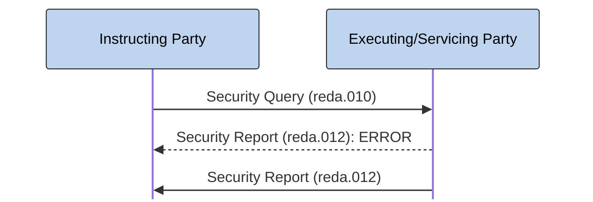

# Security query and report exchange

[src-000377](../../../../../../../../raw-input/target2securities_t2s/ISO20022_MDR_Target2Securities_August_2026_v1.zip) archive member `ISO20022_MDR_Target2Securities_August_2026_v1/Target2-Securities_SecuritiesReferenceData_MessageSet/ISO20022_MDRPart1_Target2Securities_SecuritiesReferenceData_v2.docx`; direct-body paragraph P296; BusinessTransactions / Query/Response Process / Security Query/Security Report Scenario; rendered Word file page 28.

[Complete source figure / composite](../../../../../../assets/src-000377/word-page-context/page-0028.png) · [Whole Word-page context](../../../../../../assets/src-000377/word-page-context/page-0028.png)

## Mermaid reconstruction

## Participants and responsibilities

- [Instructing Party](../../../../../../../../shared/reference/participants/participant-src-000377-instructing-party.md)
- [Executing/Servicing Party](../../../../../../../../shared/reference/participants/participant-src-000377-executing-servicing-party.md)

| Step | Sender | Receiver | Literal source message | Line |
| --- | --- | --- | --- | --- |
| 1 | Instructing Party | Executing/Servicing Party | Security Query (reda.010) | solid |
| 2 | Executing/Servicing Party | Instructing Party | Security Report (reda.012): ERROR | dashed |
| 3 | Executing/Servicing Party | Instructing Party | Security Report (reda.012) | solid |

[Reusable flow, conditions and source narrative](../../flows/flow-src-000377-p294-security-query-security-report-scenario.md)

## Source tables and limitations

- [T11](../../documents/src-000377/tables/tbl-0011.md)
- [T17](../../documents/src-000377/tables/tbl-0017.md)

- The error path is conditional on excessive processing time, an unsuitable criteria combination or no result set (P300). The picture does not use an alt frame, so both literal arrows remain without declaring both responses mandatory. No timeout threshold is supplied.
- Source377 is June2021; companion source378 is March2024. Matching full identifiers do not erase the publication difference (issue-000010).
- The original figure is assembled from native Word connector/text objects and institutional pictograms. The retained full Word page is the complete composite; its pictograms alone are not counted as diagrams.
- Native Mermaid participant boxes replace the institutional drawings; sender and receiver roles, solid/dashed lines and visible arrow direction remain explicit. No institution is equated with a functional role.

[issue-000010 publication difference; issue-000051 copied role/restriction wording](../../../../../../../../tracking/issues.md)

<!-- SECURITIES-REFERENCE-DIAGRAM-REVIEW-START -->
## Completed rendering and visual review

Mermaid browser API + Chromium 156.0.8078.81; Mermaid 12.3.0; 2026-11-09: parse/render **pass**. [Rendered SVG](../../../../../../assets/src-000377/securities-reference/fig-0018.svg) · [Rendered PNG](../../../../../../assets/src-000377/securities-reference/fig-0018.png).

Each original figure and final Mermaid render was directly compared for all labels, endpoints, arrow direction, solid/dashed connectors, decision branches and lane/role boundaries. Native composites12–20 were inspected as full Word pages; figures1–2 received explicit high-priority role/process review. Extraction-fidelity comparison **pass with the page’s explicit notation limitations**. Whole Word page 28 was also inspected. This does not resolve source ambiguities or claim review of hidden native-application layers.

[Hash-bound review evidence](../../../../../../../../tracking/reviews/securities-reference-diagrams.json).

<!-- SECURITIES-REFERENCE-DIAGRAM-REVIEW-END -->
