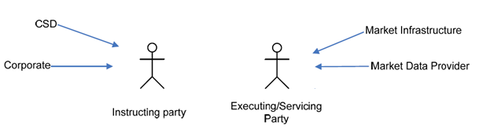

# fig-0001 - original figure evidence

Source: [src-000377](../../../../../../../../../raw-input/target2securities_t2s/ISO20022_MDR_Target2Securities_August_2026_v1.zip) archive member `ISO20022_MDR_Target2Securities_August_2026_v1/Target2-Securities_SecuritiesReferenceData_MessageSet/ISO20022_MDRPart1_Target2Securities_SecuritiesReferenceData_v2.docx`. Locator: direct-body paragraph P138; BusinessRoles and Participants; /w:document/w:body/w:p[138].

Original extracted asset: [image1.png](../../../../../../../assets/src-000377/originals/image1.png)

## Canonical reconstruction and review

[Canonical diagram, source qualifications, participant/flow links and recorded review evidence](../../../diagrams/securities-reference/fig-0001.md). Original media and this occurrence's precise locator are retained. Rendering and visual comparison results above are copied from the canonical reference; any unresolved business, version or contextual limitation remains open.

<!-- SECREF-CANONICAL-START -->
[Canonical complete reconstruction and review evidence](../../../diagrams/securities-reference/fig-0001.md)
<!-- SECREF-CANONICAL-END -->

<!-- SECURITIES-REFERENCE-REVIEW-START -->
[Completed canonical reconstruction and review evidence](../../../diagrams/securities-reference/fig-0001.md)
<!-- SECURITIES-REFERENCE-REVIEW-END -->
