# T2S securities reference-data conceptual model

[src-000379](../../../../../../../../../raw-input/target2securities_t2s/ISO20022_MDR_Target2Securities_August_2026_v1.zip) archive member `ISO20022_MDR_Target2Securities_August_2026_v1/Target2-Securities_SecuritiesReferenceData_MessageSet/ISO20022_MDRPart3_Target2Securities_SecuritiesReferenceData_v1.xlsx`, SecuritiesRefData!A1:AN59; xl/drawings/drawing2.xml; anchor 1. Original image SHA-256: d9e404940445e25dc74a474dd5af0ec2fc863dc5958497fd97a1e4f7574f2167.

[Original complete figure](../../../../../../../assets/src-000379/media/image2.png) · [Rendered Mermaid SVG](../../../../../../../assets/src-000379/reconstructed/src-000379-fig-0002.svg) · [Rendered Mermaid PNG](../../../../../../../assets/src-000379/reconstructed/src-000379-fig-0002.png)

## Source reconstruction

```mermaid
classDiagram
direction TB
class Collateral["Collateral"] {
<<BusinessComponent>>
}
class Account["Account"] {
<<BusinessComponent>>
}
class SecuritiesAccount["SecuritiesAccount"] {
<<BusinessComponent>>
}
class System["System"] {
<<BusinessComponent>>
}
class SystemPartyRole["SystemPartyRole"] {
<<BusinessComponent>>
}
class Location["Location"] {
<<BusinessComponent>>
}
class Country["Country"] {
<<BusinessComponent>>
}
class PostalAddress["PostalAddress"] {
<<BusinessComponent>>
}
class ContactPoint["ContactPoint"] {
<<BusinessComponent>>
}
class AccountIdentification["AccountIdentification"] {
<<BusinessComponent>>
}
class GenericIdentification["GenericIdentification"] {
<<BusinessComponent>>
}
class PartyIdentificationPrimary["PartyIdentificationInformation"] {
<<BusinessComponent>>
}
class PartyIdentificationRepeated["PartyIdentificationInformation"] {
<<BusinessComponent>>
}
class PartyName["PartyName"] {
<<BusinessComponent>>
}
class OrganisationIdentification["OrganisationIdentification"] {
<<BusinessComponent>>
}
class Organisation["Organisation"] {
<<BusinessComponent>>
}
class Scheme["Scheme"] {
<<BusinessComponent>>
}
class StatusReason["StatusReason"] {
<<BusinessComponent>>
}
class Status["Status"] {
<<BusinessComponent>>
}
class SecuritiesStatus["SecuritiesStatus"] {
<<BusinessComponent>>
}
class AssetHolding["AssetHolding"] {
<<BusinessComponent>>
}
class HaircutValuation["HaircutValuation"] {
<<BusinessComponent>>
}
class Asset["Asset"] {
<<BusinessComponent>>
}
class AssetClassification["AssetClassification"] {
<<BusinessComponent>>
}
class Derivative["Derivative"] {
<<BusinessComponent>>
}
class Option["Option"] {
<<BusinessComponent>>
}
class Future["Future"] {
<<BusinessComponent>>
}
class Issuance["Issuance"] {
<<BusinessComponent>>
}
class SecuritiesPricing["SecuritiesPricing"] {
<<BusinessComponent>>
}
class YieldCalculation["YieldCalculation"] {
<<BusinessComponent>>
}
class RateAndAmount["RateAndAmount"] {
<<BusinessComponent>>
}
class VariableInterest["VariableInterest"] {
<<BusinessComponent>>
}
class InterestCalculation["InterestCalculation"] {
<<BusinessComponent>>
}
class SecuritiesTax["SecuritiesTax"] {
<<BusinessComponent>>
}
class TradingMarket["TradingMarket"] {
<<BusinessComponent>>
}
class SecuritiesQuantity["SecuritiesQuantity"] {
<<BusinessComponent>>
}
class Security["Security"] {
<<BusinessComponent>>
}
class Warrant["Warrant"] {
<<BusinessComponent>>
}
class Debt["Debt"] {
<<BusinessComponent>>
}
class DateTimePeriod["DateTimePeriod"] {
<<BusinessComponent>>
}
class SecuritiesRestriction["SecuritiesRestriction"] {
<<BusinessComponent>>
}
Collateral -- Account : + RelatedCollateralProcess / + CollateralAccount
Collateral -- AssetHolding : - IndependentAmountCollateral / + SegregatedIndependentAmountAssetHolding
AssetHolding -- HaircutValuation : + Haircut
AssetHolding -- Asset : + AssetValue
Asset -- AssetClassification
Asset -- Issuance : + IssuedAsset
AssetClassification -- Scheme : - AssetClassScheme
Derivative --|> Asset
Derivative -- Asset : + UnderlyingAsset
Option --|> Derivative
Future --|> Derivative
Derivative -- SecuritiesPricing : + ExercisePrice
Issuance -- SecuritiesPricing : - OriginalIssueDiscount
YieldCalculation -- SecuritiesPricing : + RedemptionPrice
YieldCalculation -- RateAndAmount : - YieldRange
YieldCalculation -- VariableInterest : + RelatedYieldCalculation
RateAndAmount -- SecuritiesTax : - RelatedTax
VariableInterest -- InterestCalculation
VariableInterest -- Security : + RelatedVariableInterest / + BenchmarkReference
InterestCalculation -- Debt : + NextInterest / + DebtInstrument
InterestCalculation -- DateTimePeriod : + RelatedInterestCalculation / + InterestPeriod
SecuritiesTax -- Security : + TaxDetails
Security -- SecuritiesRestriction : + Restriction
Security -- SecuritiesQuantity : + SecurityIdentification
Warrant --|> Security
Debt --|> Security
SecuritiesPricing -- Warrant : - SubscriptionPrice / + RelatedWarrant
SecuritiesQuantity -- Debt : - MinimumDenomination / + MinimumDenominationDebt
SecuritiesQuantity -- Debt : - MinimumIncrement / + MinimumIncrementDebt
TradingMarket -- SecuritiesQuantity : - MaximumTradedQuantityMarket / - MaximumTradedNominalQuantity
TradingMarket -- SecuritiesQuantity : - MinimumTradedQuantityMarket / - MinimumTradedNominalQuantity
TradingMarket -- Security : + PlaceOfListing / + ListedSecurity
TradingMarket -- Security : + TradedSecurity
Debt -- DateTimePeriod : + ExtendiblePeriodDebt / - ExtendiblePeriod
Debt -- DateTimePeriod : + CustomDateDebt / - CustomDate
SecuritiesStatus --|> Status
StatusReason -- Status
SecuritiesStatus -- Security
System -- Account
System -- SystemPartyRole : + RelatedSystem / + PartyRole
System -- Location
Location -- PostalAddress : + Address
Country -- PostalAddress : + PostalAddressSpecification
PostalAddress --|> ContactPoint
ContactPoint -- GenericIdentification : + IdentificationForContactPoint / + Identification
Account -- AccountIdentification : + Identification
SecuritiesAccount --|> Account
AccountIdentification -- GenericIdentification : + IdentificationForAccountCostReferencePattern / + CostReferencePattern
GenericIdentification -- Scheme : + Identification
GenericIdentification -- StatusReason : + DataSourceScheme / - RelatedStatusReason
GenericIdentification -- PartyIdentificationPrimary : - OtherIdentification / + RelatedPartyIdentification
GenericIdentification -- PartyIdentificationRepeated : - OtherIdentification / + RelatedPartyIdentification
PartyIdentificationPrimary -- PartyName : + PartyIdentification
PartyIdentificationRepeated -- PartyName : + PartyName / + PartyIdentification
OrganisationIdentification --|> PartyIdentificationPrimary
OrganisationIdentification --|> PartyIdentificationRepeated
OrganisationIdentification -- Organisation
PartyIdentificationRepeated -- DateTimePeriod : - RelatedIdentification / + ValidityPeriod
```

## Entities and relationships

The complete model connects collateral/account reference data with assets, issuance, derivatives, market quantities, securities restrictions, pricing, tax, debt/interest and identification. PartyIdentificationInformation is visibly drawn twice; both occurrences and their separately drawn links are retained. Derivative–Asset combines an overlapping generalization and UnderlyingAsset association, separated using FullBusinessModel!A2367:F2368. Other parallel relationships remain distinct: maximum/minimum market quantities, market listing/trading, debt denomination/increment and extendible/custom periods. The source’s + RelatedYieldCalculation label is located at the YieldCalculation–VariableInterest route and is retained there in this reconstruction. The table instead associates RelatedYieldCalculation with YieldCalculation–RateAndAmount (row 3100); rows 3101 and 2347 define the variable-interest relationship. This discrepancy is explicit and prevents a reviewed status. Displaced GenericIdentification labels were reconciled with exact rows 154, 156, 159 and 164: IdentificationForContactPoint/Identification, OtherIdentification/RelatedPartyIdentification, scheme Identification, and DataSourceScheme/RelatedStatusReason respectively. No numeric cardinalities are printed.

All 41 visible node occurrences and 58 relationship lines are retained. No numeric multiplicity is shown in this source view, so none is inferred. The source prints no package names or enclosing package boundaries, and none are added. Repeated entity occurrences retain separate diagram IDs but the same visible source label. Association labels retain literal +/− prefixes and combined end names. Their re-layout position is not additional navigability evidence. The native class inheritance marker is reserved for the source’s hollow-triangle generalizations. Source editor/navigation icons are omitted as interface decoration; no business entity or relationship is excluded.

## Complete relationship register

| From node | To node | Source relationship kind | Visible source label(s) | From-end multiplicity | To-end multiplicity |
| --- | --- | --- | --- | --- | --- |
| Collateral | Account | association | + RelatedCollateralProcess / + CollateralAccount | not printed | not printed |
| Collateral | AssetHolding | association | - IndependentAmountCollateral / + SegregatedIndependentAmountAssetHolding | not printed | not printed |
| AssetHolding | HaircutValuation | association | + Haircut | not printed | not printed |
| AssetHolding | Asset | association | + AssetValue | not printed | not printed |
| Asset | AssetClassification | association | (unlabelled in source) | not printed | not printed |
| Asset | Issuance | association | + IssuedAsset | not printed | not printed |
| AssetClassification | Scheme | association | - AssetClassScheme | not printed | not printed |
| Derivative | Asset | generalization: subtype to supertype | (unlabelled in source) | not printed | not printed |
| Derivative | Asset | association | + UnderlyingAsset | not printed | not printed |
| Option | Derivative | generalization: subtype to supertype | (unlabelled in source) | not printed | not printed |
| Future | Derivative | generalization: subtype to supertype | (unlabelled in source) | not printed | not printed |
| Derivative | SecuritiesPricing | association | + ExercisePrice | not printed | not printed |
| Issuance | SecuritiesPricing | association | - OriginalIssueDiscount | not printed | not printed |
| YieldCalculation | SecuritiesPricing | association | + RedemptionPrice | not printed | not printed |
| YieldCalculation | RateAndAmount | association | - YieldRange | not printed | not printed |
| YieldCalculation | VariableInterest | association | + RelatedYieldCalculation | not printed | not printed |
| RateAndAmount | SecuritiesTax | association | - RelatedTax | not printed | not printed |
| VariableInterest | InterestCalculation | association | (unlabelled in source) | not printed | not printed |
| VariableInterest | Security | association | + RelatedVariableInterest / + BenchmarkReference | not printed | not printed |
| InterestCalculation | Debt | association | + NextInterest / + DebtInstrument | not printed | not printed |
| InterestCalculation | DateTimePeriod | association | + RelatedInterestCalculation / + InterestPeriod | not printed | not printed |
| SecuritiesTax | Security | association | + TaxDetails | not printed | not printed |
| Security | SecuritiesRestriction | association | + Restriction | not printed | not printed |
| Security | SecuritiesQuantity | association | + SecurityIdentification | not printed | not printed |
| Warrant | Security | generalization: subtype to supertype | (unlabelled in source) | not printed | not printed |
| Debt | Security | generalization: subtype to supertype | (unlabelled in source) | not printed | not printed |
| SecuritiesPricing | Warrant | association | - SubscriptionPrice / + RelatedWarrant | not printed | not printed |
| SecuritiesQuantity | Debt | association | - MinimumDenomination / + MinimumDenominationDebt | not printed | not printed |
| SecuritiesQuantity | Debt | association | - MinimumIncrement / + MinimumIncrementDebt | not printed | not printed |
| TradingMarket | SecuritiesQuantity | association | - MaximumTradedQuantityMarket / - MaximumTradedNominalQuantity | not printed | not printed |
| TradingMarket | SecuritiesQuantity | association | - MinimumTradedQuantityMarket / - MinimumTradedNominalQuantity | not printed | not printed |
| TradingMarket | Security | association | + PlaceOfListing / + ListedSecurity | not printed | not printed |
| TradingMarket | Security | association | + TradedSecurity | not printed | not printed |
| Debt | DateTimePeriod | association | + ExtendiblePeriodDebt / - ExtendiblePeriod | not printed | not printed |
| Debt | DateTimePeriod | association | + CustomDateDebt / - CustomDate | not printed | not printed |
| SecuritiesStatus | Status | generalization: subtype to supertype | (unlabelled in source) | not printed | not printed |
| StatusReason | Status | association | (unlabelled in source) | not printed | not printed |
| SecuritiesStatus | Security | association | (unlabelled in source) | not printed | not printed |
| System | Account | association | (unlabelled in source) | not printed | not printed |
| System | SystemPartyRole | association | + RelatedSystem / + PartyRole | not printed | not printed |
| System | Location | association | (unlabelled in source) | not printed | not printed |
| Location | PostalAddress | association | + Address | not printed | not printed |
| Country | PostalAddress | association | + PostalAddressSpecification | not printed | not printed |
| PostalAddress | ContactPoint | generalization: subtype to supertype | (unlabelled in source) | not printed | not printed |
| ContactPoint | GenericIdentification | association | + IdentificationForContactPoint / + Identification | not printed | not printed |
| Account | AccountIdentification | association | + Identification | not printed | not printed |
| SecuritiesAccount | Account | generalization: subtype to supertype | (unlabelled in source) | not printed | not printed |
| AccountIdentification | GenericIdentification | association | + IdentificationForAccountCostReferencePattern / + CostReferencePattern | not printed | not printed |
| GenericIdentification | Scheme | association | + Identification | not printed | not printed |
| GenericIdentification | StatusReason | association | + DataSourceScheme / - RelatedStatusReason | not printed | not printed |
| GenericIdentification | PartyIdentificationPrimary | association | - OtherIdentification / + RelatedPartyIdentification | not printed | not printed |
| GenericIdentification | PartyIdentificationRepeated | association | - OtherIdentification / + RelatedPartyIdentification | not printed | not printed |
| PartyIdentificationPrimary | PartyName | association | + PartyIdentification | not printed | not printed |
| PartyIdentificationRepeated | PartyName | association | + PartyName / + PartyIdentification | not printed | not printed |
| OrganisationIdentification | PartyIdentificationPrimary | generalization: subtype to supertype | (unlabelled in source) | not printed | not printed |
| OrganisationIdentification | PartyIdentificationRepeated | generalization: subtype to supertype | (unlabelled in source) | not printed | not printed |
| OrganisationIdentification | Organisation | association | (unlabelled in source) | not printed | not printed |
| PartyIdentificationRepeated | DateTimePeriod | association | - RelatedIdentification / + ValidityPeriod | not printed | not printed |

## Entity definitions and precise workbook locators

| Visible label | Source package / stereotype | Definition evidence |
| --- | --- | --- |
| Collateral | not printed in figure / BusinessComponent | [FullBusinessModel!A2586:D2586](../sheets/02-fullbusinessmodel/tbl-0014.md) — Assets pledged by a debtor to secure a loan or an exposure and subject to seizure in the event of default. |
| Account | not printed in figure / BusinessComponent | [FullBusinessModel!A521:D521](../sheets/02-fullbusinessmodel/tbl-0004.md) — Record of transactions in specific types of assets, maintained by a servicing party on behalf of one or more owning parties. Business relationship between an account servicer and one or more account owners. |
| SecuritiesAccount | not printed in figure / BusinessComponent | [FullBusinessModel!A764:D764](../sheets/02-fullbusinessmodel/tbl-0005.md) — Account to or from which a securities entry is made. |
| System | not printed in figure / BusinessComponent | [FullBusinessModel!A1664:D1664](../sheets/02-fullbusinessmodel/tbl-0010.md) — Set of integrated applications that provides centralised services such as clearing, netting, reconciliation, trading and/or settlement. |
| SystemPartyRole | not printed in figure / BusinessComponent | [FullBusinessModel!A1700:D1700](../sheets/02-fullbusinessmodel/tbl-0010.md) — Role played by a party in a system. |
| Location | not printed in figure / BusinessComponent | [FullBusinessModel!A596:D596](../sheets/02-fullbusinessmodel/tbl-0004.md) — Specifies a place. |
| Country | not printed in figure / BusinessComponent | [FullBusinessModel!A203:D203](../sheets/02-fullbusinessmodel/tbl-0003.md) — Nation with its own government. |
| PostalAddress | not printed in figure / BusinessComponent | [FullBusinessModel!A441:D441](../sheets/02-fullbusinessmodel/tbl-0004.md) — Information that locates and identifies a specific address. |
| ContactPoint | not printed in figure / BusinessComponent | [FullBusinessModel!A423:D423](../sheets/02-fullbusinessmodel/tbl-0004.md) — Number, physical or virtual address, used for communication. |
| AccountIdentification | not printed in figure / BusinessComponent | [FullBusinessModel!A585:D585](../sheets/02-fullbusinessmodel/tbl-0004.md) — Unique identifier of an account, as assigned by the account servicer. |
| GenericIdentification | not printed in figure / BusinessComponent | [FullBusinessModel!A152:D152](../sheets/02-fullbusinessmodel/tbl-0002.md) — Information related to a non-standardised identification, such as a proprietary party identification or account identification. |
| PartyIdentificationInformation | not printed in figure / BusinessComponent | [FullBusinessModel!A476:D476](../sheets/02-fullbusinessmodel/tbl-0004.md) — Unique and unambiguous way to identify a party |
| PartyIdentificationInformation | not printed in figure / BusinessComponent | [FullBusinessModel!A476:D476](../sheets/02-fullbusinessmodel/tbl-0004.md) — Unique and unambiguous way to identify a party |
| PartyName | not printed in figure / BusinessComponent | [FullBusinessModel!A420:D420](../sheets/02-fullbusinessmodel/tbl-0004.md) — Name by which a party is known and which is usually used to identify that party. |
| OrganisationIdentification | not printed in figure / BusinessComponent | [FullBusinessModel!A490:D490](../sheets/02-fullbusinessmodel/tbl-0004.md) — Unique and unambiguous way to identify an organisation. |
| Organisation | not printed in figure / BusinessComponent | [FullBusinessModel!A395:D395](../sheets/02-fullbusinessmodel/tbl-0003.md) — Organised structure that is set up for a particular purpose. For example, a business, government body, department, charity, or financial institution. |
| Scheme | not printed in figure / BusinessComponent | [FullBusinessModel!A678:D678](../sheets/02-fullbusinessmodel/tbl-0005.md) — Information regarding an enumerated code list and its owner. |
| StatusReason | not printed in figure / BusinessComponent | [FullBusinessModel!A1521:D1521](../sheets/02-fullbusinessmodel/tbl-0009.md) — Specifies the underlying reason for the status of an object. |
| Status | not printed in figure / BusinessComponent | [FullBusinessModel!A889:D889](../sheets/02-fullbusinessmodel/tbl-0006.md) — The status of an instruction, advice or request. |
| SecuritiesStatus | not printed in figure / BusinessComponent | [FullBusinessModel!A2334:D2334](../sheets/02-fullbusinessmodel/tbl-0013.md) — Specifies the status of the security within its lifecycle. |
| AssetHolding | not printed in figure / BusinessComponent | [FullBusinessModel!A1622:D1622](../sheets/02-fullbusinessmodel/tbl-0010.md) — Specifies in terms of value and quantity the assets. |
| HaircutValuation | not printed in figure / BusinessComponent | [FullBusinessModel!A2999:D2999](../sheets/02-fullbusinessmodel/tbl-0016.md) — Basic valuation details of an asset's market value. |
| Asset | not printed in figure / BusinessComponent | [FullBusinessModel!A2:D2](../sheets/02-fullbusinessmodel/tbl-0002.md) — Tangible items of value to a business. |
| AssetClassification | not printed in figure / BusinessComponent | [FullBusinessModel!A2359:D2359](../sheets/02-fullbusinessmodel/tbl-0013.md) — Other classification type of the security, ie, other than ISO 10962. |
| Derivative | not printed in figure / BusinessComponent | [FullBusinessModel!A2367:D2367](../sheets/02-fullbusinessmodel/tbl-0013.md) — Specifies the parameters of a derivative instrument based on a specific asset. |
| Option | not printed in figure / BusinessComponent | [FullBusinessModel!A2378:D2378](../sheets/02-fullbusinessmodel/tbl-0013.md) — Contracts which grant to the holder either the privilege to purchase or the privilege to sell the assets specified at a predetermined price or formula at or within a time in the future. |
| Future | not printed in figure / BusinessComponent | [FullBusinessModel!A2439:D2439](../sheets/02-fullbusinessmodel/tbl-0014.md) — Parameters for contracts which obligate the buyer to receive and the seller to deliver in the future the assets specified at an agreed price. |
| Issuance | not printed in figure / BusinessComponent | [FullBusinessModel!A2408:D2408](../sheets/02-fullbusinessmodel/tbl-0014.md) — Preparation/bringing to market of a security (also known as primary market or Initial Public Offering (IPO) issuance). |
| SecuritiesPricing | not printed in figure / BusinessComponent | [FullBusinessModel!A310:D310](../sheets/02-fullbusinessmodel/tbl-0003.md) — Characteristics related to the price of the security. |
| YieldCalculation | not printed in figure / BusinessComponent | [FullBusinessModel!A3093:D3093](../sheets/02-fullbusinessmodel/tbl-0017.md) — Characteristics related to the yield. |
| RateAndAmount | not printed in figure / BusinessComponent | [FullBusinessModel!A2839:D2839](../sheets/02-fullbusinessmodel/tbl-0016.md) — Specifies the value expressed as a rate or an amount. For example, the value of a tax or a commission. |
| VariableInterest | not printed in figure / BusinessComponent | [FullBusinessModel!A2339:D2339](../sheets/02-fullbusinessmodel/tbl-0013.md) — Specifies the estimated interest rate and the parameters used for determining its value. |
| InterestCalculation | not printed in figure / BusinessComponent | [FullBusinessModel!A2249:D2249](../sheets/02-fullbusinessmodel/tbl-0013.md) — Set of parameters used to calculate an interest amount. |
| SecuritiesTax | not printed in figure / BusinessComponent | [FullBusinessModel!A1037:D1037](../sheets/02-fullbusinessmodel/tbl-0007.md) — Amount of money due to the government or tax authority, according to various pre-defined parameters such as thresholds or income. |
| TradingMarket | not printed in figure / BusinessComponent | [FullBusinessModel!A633:D633](../sheets/02-fullbusinessmodel/tbl-0005.md) — Context or geographic environment in which trading parties may meet in order to negotiate and execute trades among themselves. It also identifies the primary market where an asset is issued. |
| SecuritiesQuantity | not printed in figure / BusinessComponent | [FullBusinessModel!A1402:D1402](../sheets/02-fullbusinessmodel/tbl-0009.md) — Quantity of a security. |
| Security | not printed in figure / BusinessComponent | [FullBusinessModel!A22:D22](../sheets/02-fullbusinessmodel/tbl-0002.md) — Financial instruments representing a sum of rights of the investor vis-a-vis the issuer. |
| Warrant | not printed in figure / BusinessComponent | [FullBusinessModel!A2447:D2447](../sheets/02-fullbusinessmodel/tbl-0014.md) — Financial instrument that gives the holder the right to purchase shares or bonds at a given price within a specified time. |
| Debt | not printed in figure / BusinessComponent | [FullBusinessModel!A2269:D2269](../sheets/02-fullbusinessmodel/tbl-0013.md) — Financial instruments evidencing moneys owed by the issuer to the holder on terms as specified. |
| DateTimePeriod | not printed in figure / BusinessComponent | [FullBusinessModel!A693:D693](../sheets/02-fullbusinessmodel/tbl-0005.md) — Time span defined by a start date and time, and an end date and time. |
| SecuritiesRestriction | not printed in figure / BusinessComponent | [FullBusinessModel!A2509:D2509](../sheets/02-fullbusinessmodel/tbl-0014.md) — Restrictions applicable to the security. |

## Participant and flow navigation

This is a conceptual entity model, not a message exchange diagram. A business component or relationship label is not automatically a functional participant or institution. [Message-set participant references](../../../participants.md) and [Message-set business flows](../../../flows/index.md) provide the independently sourced actor/process context. These references are navigational; source figure associations do not establish message direction.

## Rendering and visual review

2026-11-09: Mermaid 12.3.0 parsed and rendered successfully with Mermaid browser API + Chromium 156.0.8078.81. Compared final Mermaid PNG and original complete artwork plus three readable crops. Reconciled all node occurrences, literal labels, generalization directions and visible associations. Independently checked shared-route relationships against the cited FullBusinessModel rows. Original image retained; no numerical multiplicity invented. The RelatedYieldCalculation source image/table conflict remains unresolved as issue-000029; visual comparison is complete but that endpoint interpretation is not marked reviewed. [Renderer evidence](../../../../../../../../../work/t2s-large-workbook-models/render-report.json).

Remaining limitations: The source diagram places + RelatedYieldCalculation near YieldCalculation–VariableInterest, while FullBusinessModel row 3100 makes it the opposite end of YieldRange on YieldCalculation–RateAndAmount. Both source claims are retained; endpoint-label interpretation needs review. See issue-000029.
