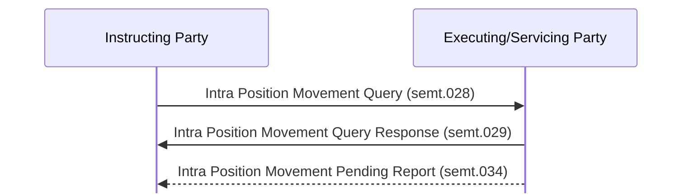

# Intra-position movement query, response and pending report

[src-000380](../../../../../../../../raw-input/target2securities_t2s/ISO20022_MDR_Target2Securities_August_2026_v1.zip) archive member `ISO20022_MDR_Target2Securities_August_2026_v1/Target2-Securities_SettlementRestrictions_MessageSet/ISO20022_MDRPart1_Target2Securities_SettlementRestrictions_v2.docx`; direct-body paragraph P97; Scope and Functionality / Scope / Intra Position Movement Query, Query Response and Pending Report; rendered Word file page 6.

[Complete original figure / composite](../../../../../../assets/src-000380/originals/image1.png) · [Whole Word-page context](../../../../../../assets/src-000380/word-page-context/page-0006.png)

## Mermaid reconstruction

## Participants and source relationships

- [Instructing Party](../../../../../../../../shared/reference/participants/participant-src-000380-instructing-party.md)
- [Executing / Servicing Party](../../../../../../../../shared/reference/participants/participant-src-000380-executing-servicing-party.md)

| Step | Sender | Receiver | Literal source message | Line |
| --- | --- | --- | --- | --- |
| 1 | Instructing Party | Executing/Servicing Party | Intra Position Movement Query (semt.028) | solid |
| 2 | Executing/Servicing Party | Instructing Party | Intra Position Movement Query Response (semt.029) | solid |
| 3 | Executing/Servicing Party | Instructing Party | Intra Position Movement Pending Report (semt.034) | dashed |

[Reusable flow, triggers, conditions and alternatives](../../flows/flow-src-000380-p91-intra-position-movement-query-response-and-pending-report.md)

## Source tables and limitations

- [T4](../../documents/src-000380/tables/tbl-0004.md)
- [T5](../../documents/src-000380/tables/tbl-0005.md)
- [T6](../../documents/src-000380/tables/tbl-0006.md)
- [T7](../../documents/src-000380/tables/tbl-0007.md)
- [T8](../../documents/src-000380/tables/tbl-0008.md)

- The first two messages are the pull query/response; the dotted pending-report arrow is an independently configured push report, not a compulsory third step after every query (P98–P99).
- Source arrows distinguish query green, response black and pending report blue. Native sequence rendering retains labels and line styles; these colors are stated here rather than interpreted as extra message states.

[issue-000056: source wording remains visible](../../../../../../../../tracking/issues.md)

<!-- SETTLEMENT-RESTRICTIONS-DIAGRAM-REVIEW-START -->
## Completed rendering and visual review

Mermaid browser API + Chromium 156.0.8078.81; Mermaid 12.3.0; 2026-11-09: parse/render **pass**. [Rendered SVG](../../../../../../assets/src-000380/settlement-restrictions/fig-0001.svg) · [Rendered PNG](../../../../../../assets/src-000380/settlement-restrictions/fig-0001.png).

All ten original figures and final Mermaid renderings were directly compared for labels, endpoints, message direction, solid/dashed connectors, decision branches and scoped roles. Figures2–3 were checked as complete native Word composites on pages7–8. Role/process scope figure4 and native use-case figure5 received explicit label/edge review. Source colors, pictograms and bar geometry have the documented notation adaptations. Extraction-fidelity comparison **pass with the page’s explicit notation limitations**. Whole Word page 6 was also inspected. This does not resolve source ambiguities or claim review of hidden native-application layers.

[Hash-bound review evidence](../../../../../../../../tracking/reviews/settlement-restrictions-diagrams.json).

<!-- SETTLEMENT-RESTRICTIONS-DIAGRAM-REVIEW-END -->
