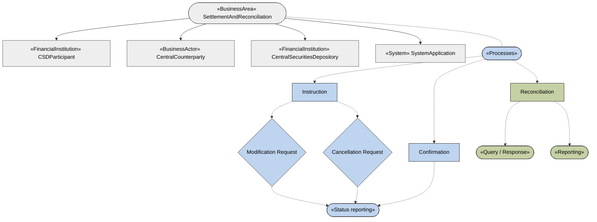

# Settlement Restrictions business-area, role and process scope

[src-000380](../../../../../../../../raw-input/target2securities_t2s/ISO20022_MDR_Target2Securities_August_2026_v1.zip) archive member `ISO20022_MDR_Target2Securities_August_2026_v1/Target2-Securities_SettlementRestrictions_MessageSet/ISO20022_MDRPart1_Target2Securities_SettlementRestrictions_v2.docx`; direct-body paragraph P237; BusinessRoles and Participants; rendered Word file page 13.

[Complete original figure / composite](../../../../../../assets/src-000380/originals/image6.png) · [Whole Word-page context](../../../../../../assets/src-000380/word-page-context/page-0013.png)

## Mermaid reconstruction

## Participants and source relationships

- [CSDParticipant](../../../../../../../../shared/reference/participants/participant-src-000380-csd-participant.md)
- [Central Counterparty](../../../../../../../../shared/reference/participants/participant-src-000380-central-counterparty.md)
- [Central Securities Depositories (CSD)](../../../../../../../../shared/reference/participants/participant-src-000380-central-securities-depositories-csd.md)
- [SystemApplication](../../../../../../../../shared/reference/participants/participant-src-000380-system-application.md)
- [Instructing Party](../../../../../../../../shared/reference/participants/participant-src-000380-instructing-party.md)
- [Executing / Servicing Party](../../../../../../../../shared/reference/participants/participant-src-000380-executing-servicing-party.md)
- [Settlement Infrastructure](../../../../../../../../shared/reference/participants/participant-src-000380-settlement-infrastructure.md)
- [Direct Connected Participant (DCP)](../../../../../../../../shared/reference/participants/participant-src-000380-direct-connected-participant-dcp.md)
- [T2S Operator](../../../../../../../../shared/reference/participants/participant-src-000380-t2s-operator.md)

The transcription retains all source node labels, visible endpoints, arrow directions, process/lane boundaries and decision labels. Activity responsibilities are defined separately by the source tables; the scope diagrams do not establish a runtime message order.

## Source tables and limitations

- [T5](../../documents/src-000380/tables/tbl-0005.md)
- [T6](../../documents/src-000380/tables/tbl-0006.md)
- [T7](../../documents/src-000380/tables/tbl-0007.md)

- This is a mixed business-area/process-scope figure, not an ordered transaction. Flowchart notation preserves the source rectangles, diamonds, ellipses, stereotype labels and solid/dashed edge semantics. Actor pictograms are replaced by labeled boxes; no inheritance or institutional equivalence is inferred from the outbound area arrows.
- Only green reconciliation/query/reporting processes are in this message set; blue instruction, confirmation, modification, cancellation and status reporting provide context (P238). The diamonds label requests in this scope map; no runtime decision condition is invented.
- P233–P235 distinguish entities from functional roles but then reuse the BusinessRole label for functional examples. Source wording is retained with the registered source issue.

[issue-000056: source wording remains visible](../../../../../../../../tracking/issues.md)

<!-- SETTLEMENT-RESTRICTIONS-DIAGRAM-REVIEW-START -->
## Completed rendering and visual review

Mermaid browser API + Chromium 156.0.8078.81; Mermaid 12.3.0; 2026-11-09: parse/render **pass**. [Rendered SVG](../../../../../../assets/src-000380/settlement-restrictions/fig-0004.svg) · [Rendered PNG](../../../../../../assets/src-000380/settlement-restrictions/fig-0004.png).

All ten original figures and final Mermaid renderings were directly compared for labels, endpoints, message direction, solid/dashed connectors, decision branches and scoped roles. Figures2–3 were checked as complete native Word composites on pages7–8. Role/process scope figure4 and native use-case figure5 received explicit label/edge review. Source colors, pictograms and bar geometry have the documented notation adaptations. Extraction-fidelity comparison **pass with the page’s explicit notation limitations**. Whole Word page 13 was also inspected. This does not resolve source ambiguities or claim review of hidden native-application layers.

[Hash-bound review evidence](../../../../../../../../tracking/reviews/settlement-restrictions-diagrams.json).

<!-- SETTLEMENT-RESTRICTIONS-DIAGRAM-REVIEW-END -->
