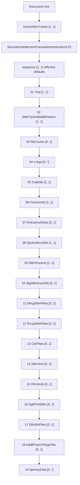

# sese.023.001.13 ordered top-level structure

This is an **XSD-derived** view. There is no original source image. It represents XML declaration order, not a business flow, ownership model or database schema. Optional blocks may be absent; repeatable blocks may repeat at their declared sequence position.

Source: [src-000214](<../../../../../../raw-input/settlement_and_reconciliation/sese.023.001.13.xsd>); namespace `urn:iso:std:iso:20022:tech:xsd:sese.023.001.13`; `Document` root declaration line4; type `Document` contains `SctiesSttlmTxInstr`; type `{urn:iso:std:iso:20022:tech:xsd:sese.023.001.13}SecuritiesSettlementTransactionInstructionV13` lines1284–1306, `xs:sequence` line1285.

## Mermaid

## Exact sequence and type navigation

The enclosing `xs:sequence` omits minOccurs and maxOccurs: both are effective defaults 1. The root payload element also has effective [1..1]. Explicit source particle attributes are distinguished below from defaults. Nested choices are not expanded into independent required fields.

| Position | XML element | Member cardinality | Source min/max attributes | Type | Source line |
| --- | --- | --- | --- | --- | --- |
| 1 | TxId | 1..1 | Both omitted; effective defaults 1 | [Max35Text](<../types/type-0099.md>) | 1286 |
| 2 | SttlmTpAndAddtlParams | 1..1 | Both omitted; effective defaults 1 | [SettlementTypeAndAdditionalParameters23](<../types/type-0194.md>) | 1287 |
| 3 | NbCounts | 0..1 | minOccurs=0, maxOccurs=1 | [NumberCount2Choice](<../types/type-0107.md>) | 1288 |
| 4 | Lnkgs | 0..* | minOccurs=0, maxOccurs=unbounded | [Linkages79](<../types/type-0082.md>) | 1289 |
| 5 | TradDtls | 1..1 | Both omitted; effective defaults 1 | [SecuritiesTradeDetails149](<../types/type-0178.md>) | 1290 |
| 6 | FinInstrmId | 1..1 | Both omitted; effective defaults 1 | [SecurityIdentification19](<../types/type-0181.md>) | 1291 |
| 7 | FinInstrmAttrbts | 0..1 | minOccurs=0, maxOccurs=1 | [FinancialInstrumentAttributes111](<../types/type-0057.md>) | 1292 |
| 8 | QtyAndAcctDtls | 1..1 | Both omitted; effective defaults 1 | [QuantityAndAccount117](<../types/type-0151.md>) | 1293 |
| 9 | SttlmParams | 1..1 | Both omitted; effective defaults 1 | [SettlementDetails220](<../types/type-0185.md>) | 1294 |
| 10 | StgSttlmInstrDtls | 0..1 | minOccurs=0, maxOccurs=1 | [StandingSettlementInstruction20](<../types/type-0197.md>) | 1295 |
| 11 | DlvrgSttlmPties | 0..1 | minOccurs=0, maxOccurs=1 | [SettlementParties126](<../types/type-0186.md>) | 1296 |
| 12 | RcvgSttlmPties | 0..1 | minOccurs=0, maxOccurs=1 | [SettlementParties126](<../types/type-0186.md>) | 1297 |
| 13 | CshPties | 0..1 | minOccurs=0, maxOccurs=1 | [CashParties41](<../types/type-0028.md>) | 1298 |
| 14 | SttlmAmt | 0..1 | minOccurs=0, maxOccurs=1 | [AmountAndDirection94](<../types/type-0015.md>) | 1299 |
| 15 | OthrAmts | 0..1 | minOccurs=0, maxOccurs=1 | [OtherAmounts45](<../types/type-0116.md>) | 1300 |
| 16 | DgtlPmtSttlm | 0..2 | minOccurs=0, maxOccurs=2 | [DigitalPaymentSettlement1](<../types/type-0045.md>) | 1301 |
| 17 | OthrBizPties | 0..1 | minOccurs=0, maxOccurs=1 | [OtherParties43](<../types/type-0118.md>) | 1302 |
| 18 | AddtlPhysOrRegnDtls | 0..1 | minOccurs=0, maxOccurs=1 | [RegistrationParameters6](<../types/type-0159.md>) | 1303 |
| 19 | SplmtryData | 0..* | minOccurs=0, maxOccurs=unbounded | [SupplementaryData1](<../types/type-0198.md>) | 1304 |

## Textual interpretation

Nineteen member declarations occur in the shown order. TxId, SttlmTpAndAddtlParams, TradDtls, FinInstrmId, QtyAndAcctDtls and SttlmParams each have effective [1..1]. Lnkgs and SplmtryData allow [0..unbounded], DgtlPmtSttlm permits [0..2], and the remaining ten members permit [0..1]. Cardinalities here apply within one instance of the enclosing sequence. Type references preserve reused types, nested compositors and restrictions.

## Review evidence

Mermaid 12.3.0 parsed and rendered the view on 2026-11-08. Compared rendered Document/payload/type/sequence and all nineteen ordered member labels and cardinalities to src-000214 complexType SecuritiesSettlementTransactionInstructionV13 sequence lines1285–1305. Confirmed six required members, ten optional single members, two optional unbounded members, and DgtlPmtSttlm 0..2. Nested choice semantics remain in linked types; no original image asserted.

[Complete schema reference](<../structure.md>)

[Validated SVG](<../../../../assets/src-000214/derived/fig-0001.svg>)

[Rendered PNG](<../../../../assets/src-000214/derived/fig-0001.png>)
