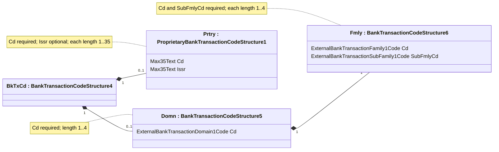

# Bank Transaction Code component structure

Source: [src-000003](../../../../../../../../raw-input/ExternalCodeSets/BTC_ExternalCodeListDescription_Nov2025.docx). P116; image15.png; source table T2 on rendered page 7 clarifies multiplicities/type names; rendered file/printed page 8.

[Complete rendered source figure (300 dpi)](../../../../../../../assets/src-000003/figure-crops/fig-0003.png) · [Full rendered source page](../../../../../../../assets/src-000003/word-render/page-08.png) · [Mermaid SVG](../../../../../../../assets/src-000003/reconstructed/fig-0003.svg) · [Mermaid preview](../../../../../../../assets/src-000003/reconstructed/fig-0003.png)

Original image: [image15.png](../../../../../../../assets/src-000003/originals/image15.png). Full structure metadata: [T2](../tables/tbl-0002.md).

## Entities and relationships

This is a code taxonomy or data-structure view. It has no business participants, process initiator, message sender/receiver or activity sequence. The publication reporting context is documented separately.

| Source label | Node |
| --- | --- |
| BankTransactionCodeStructure4 | BkTxCd |
| BankTransactionCodeStructure5 | Domn |
| BankTransactionCodeStructure6 | Fmly |
| ProprietaryBankTransactionCodeStructure1 | Prtry |

| Parent/container | Child/member | Source connector evidence |
| --- | --- | --- |
| BankTransactionCodeStructure4 | BankTransactionCodeStructure5 | visually transcribed; P116; image15.png; source table T2 on rendered page 7 clarifies multiplicities/type names |
| BankTransactionCodeStructure4 | ProprietaryBankTransactionCodeStructure1 | visually transcribed; P116; image15.png; source table T2 on rendered page 7 clarifies multiplicities/type names |
| BankTransactionCodeStructure5 | BankTransactionCodeStructure6 | visually transcribed; P116; image15.png; source table T2 on rendered page 7 clarifies multiplicities/type names |

## Representation limits

- Source XML-structure boxes and sequences are reconstructed with native class notation: composition means displayed structural containment, not business ownership. Sequence order is Domn then Prtry, domain Cd then Fmly, family Cd then SubFmlyCd, proprietary Cd then Issr. Source type labels truncated in the image are completed only from adjacent T2. The source is a publication illustration, not an independently supplied schema definition. The business requirement that Domain or Proprietary be present is separate from the displayed optional children.

## Review evidence

Compared original image15.png as displayed on Word-PDF page 8, source table T2 on page 7, and Mermaid class rendering; checked containment, sequences, field names, type names, lengths and multiplicities. Completed 2026-11-09. Rendered with Mermaid 12.3.0 and Mermaid browser API + Chromium 156.0.8078.81. Source checksum was verified against the register.
