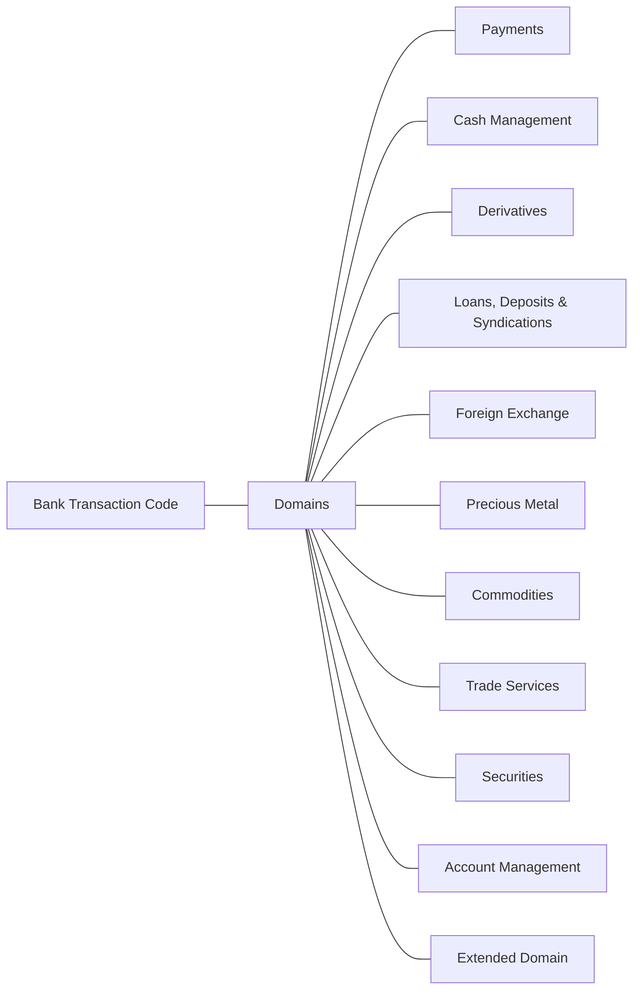

# Bank Transaction Code domains

Source: [src-000003](../../../../../../../../raw-input/ExternalCodeSets/BTC_ExternalCodeListDescription_Nov2025.docx). direct-body paragraph P136; rendered file/printed page 10.

[Complete rendered source figure (300 dpi)](../../../../../../../assets/src-000003/figure-crops/fig-0005.png) · [Full rendered source page](../../../../../../../assets/src-000003/word-render/page-10.png) · [Mermaid SVG](../../../../../../../assets/src-000003/reconstructed/fig-0005.svg) · [Mermaid preview](../../../../../../../assets/src-000003/reconstructed/fig-0005.png)

Exact SmartArt evidence: [word/diagrams/data2.xml](../smartart/data2.md). All data, drawing, layout, style and color parts are retained.

## Entities and relationships

This is a code taxonomy or data-structure view. It has no business participants, process initiator, message sender/receiver or activity sequence. The publication reporting context is documented separately.

| Source label | Node |
| --- | --- |
| Bank Transaction Code | N1 |
| Domains | N2 |
| Payments | N3 |
| Cash Management | N4 |
| Derivatives | N5 |
| Loans, Deposits &amp; Syndications | N6 |
| Foreign Exchange | N7 |
| Precious Metal | N8 |
| Commodities | N9 |
| Trade Services | N10 |
| Securities | N11 |
| Account Management | N12 |
| Extended Domain | N13 |

| Parent/container | Child/member | Source connector evidence |
| --- | --- | --- |
| Bank Transaction Code | Domains | /dgm:dataModel/dgm:cxnLst/dgm:cxn[5] |
| Domains | Payments | /dgm:dataModel/dgm:cxnLst/dgm:cxn[6] |
| Domains | Cash Management | /dgm:dataModel/dgm:cxnLst/dgm:cxn[7] |
| Domains | Derivatives | /dgm:dataModel/dgm:cxnLst/dgm:cxn[32] |
| Domains | Loans, Deposits &amp; Syndications | /dgm:dataModel/dgm:cxnLst/dgm:cxn[40] |
| Domains | Foreign Exchange | /dgm:dataModel/dgm:cxnLst/dgm:cxn[51] |
| Domains | Precious Metal | /dgm:dataModel/dgm:cxnLst/dgm:cxn[45] |
| Domains | Commodities | /dgm:dataModel/dgm:cxnLst/dgm:cxn[12] |
| Domains | Trade Services | /dgm:dataModel/dgm:cxnLst/dgm:cxn[39] |
| Domains | Securities | /dgm:dataModel/dgm:cxnLst/dgm:cxn[4] |
| Domains | Account Management | /dgm:dataModel/dgm:cxnLst/dgm:cxn[2] |
| Domains | Extended Domain | /dgm:dataModel/dgm:cxnLst/dgm:cxn[26] |

## Representation limits

- The source uses connector lines without arrowheads. Mermaid lines represent the displayed taxonomy/structure, not message directions or a time sequence. Layout and box colors differ to keep labels readable; generic-family emphasis is preserved.

## Review evidence

Compared the complete Word-PDF source page and the rendered Mermaid image. Checked each label, parent-child connector, hierarchy boundary and generic-family emphasis. SmartArt source nodes/connections provide exact text and endpoint evidence; no hidden node text is inferred. Completed 2026-11-09. Rendered with Mermaid 12.3.0 and Mermaid browser API + Chromium 156.0.8078.81. Source checksum was verified against the register.
