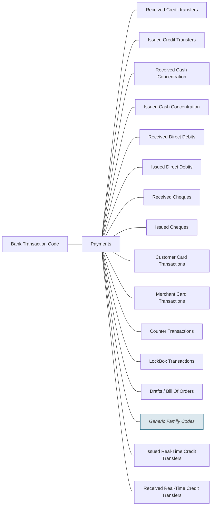

# Payments families

Source: [src-000003](../../../../../../../../raw-input/ExternalCodeSets/BTC_ExternalCodeListDescription_Nov2025.docx). direct-body paragraph P188; rendered file/printed page 24.

[Complete rendered source figure (300 dpi)](../../../../../../../assets/src-000003/figure-crops/fig-0006.png) · [Full rendered source page](../../../../../../../assets/src-000003/word-render/page-24.png) · [Mermaid SVG](../../../../../../../assets/src-000003/reconstructed/fig-0006.svg) · [Mermaid preview](../../../../../../../assets/src-000003/reconstructed/fig-0006.png)

Exact SmartArt evidence: [word/diagrams/data3.xml](../smartart/data3.md). All data, drawing, layout, style and color parts are retained.

## Entities and relationships

This is a code taxonomy or data-structure view. It has no business participants, process initiator, message sender/receiver or activity sequence. The publication reporting context is documented separately.

| Source label | Node |
| --- | --- |
| Bank Transaction Code | N1 |
| Payments | N2 |
| Received Credit transfers | N3 |
| Issued Credit Transfers | N4 |
| Received Cash Concentration | N5 |
| Issued Cash Concentration | N6 |
| Received Direct Debits | N7 |
| Issued Direct Debits | N8 |
| Received Cheques | N9 |
| Issued Cheques | N10 |
| Customer Card Transactions | N11 |
| Merchant Card Transactions | N12 |
| Counter Transactions | N13 |
| LockBox Transactions | N14 |
| Drafts / Bill Of Orders | N15 |
| Generic Family Codes | N16 |
| Issued Real-Time Credit Transfers | N17 |
| Received Real-Time Credit Transfers | N18 |

| Parent/container | Child/member | Source connector evidence |
| --- | --- | --- |
| Bank Transaction Code | Payments | /dgm:dataModel/dgm:cxnLst/dgm:cxn[35] |
| Payments | Received Credit transfers | /dgm:dataModel/dgm:cxnLst/dgm:cxn[51] |
| Payments | Issued Credit Transfers | /dgm:dataModel/dgm:cxnLst/dgm:cxn[23] |
| Payments | Received Cash Concentration | /dgm:dataModel/dgm:cxnLst/dgm:cxn[47] |
| Payments | Issued Cash Concentration | /dgm:dataModel/dgm:cxnLst/dgm:cxn[6] |
| Payments | Received Direct Debits | /dgm:dataModel/dgm:cxnLst/dgm:cxn[17] |
| Payments | Issued Direct Debits | /dgm:dataModel/dgm:cxnLst/dgm:cxn[5] |
| Payments | Received Cheques | /dgm:dataModel/dgm:cxnLst/dgm:cxn[44] |
| Payments | Issued Cheques | /dgm:dataModel/dgm:cxnLst/dgm:cxn[15] |
| Payments | Customer Card Transactions | /dgm:dataModel/dgm:cxnLst/dgm:cxn[46] |
| Payments | Merchant Card Transactions | /dgm:dataModel/dgm:cxnLst/dgm:cxn[68] |
| Payments | Counter Transactions | /dgm:dataModel/dgm:cxnLst/dgm:cxn[11] |
| Payments | LockBox Transactions | /dgm:dataModel/dgm:cxnLst/dgm:cxn[19] |
| Payments | Drafts / Bill Of Orders | /dgm:dataModel/dgm:cxnLst/dgm:cxn[28] |
| Payments | Generic Family Codes | /dgm:dataModel/dgm:cxnLst/dgm:cxn[34] |
| Payments | Issued Real-Time Credit Transfers | /dgm:dataModel/dgm:cxnLst/dgm:cxn[49] |
| Payments | Received Real-Time Credit Transfers | /dgm:dataModel/dgm:cxnLst/dgm:cxn[55] |

## Representation limits

- The source uses connector lines without arrowheads. Mermaid lines represent the displayed taxonomy/structure, not message directions or a time sequence. Layout and box colors differ to keep labels readable; generic-family emphasis is preserved.
- The figure is an overview, not an exhaustive current code list: it does not separately display the four generic families and does not add entries from later detailed tables. The original alternating left/right arrangement is represented as sibling branches.

## Review evidence

Compared the complete Word-PDF source page and the rendered Mermaid image. Checked each label, parent-child connector, hierarchy boundary and generic-family emphasis. SmartArt source nodes/connections provide exact text and endpoint evidence; no hidden node text is inferred. Completed 2026-11-09. Rendered with Mermaid 12.3.0 and Mermaid browser API + Chromium 156.0.8078.81. Source checksum was verified against the register.
