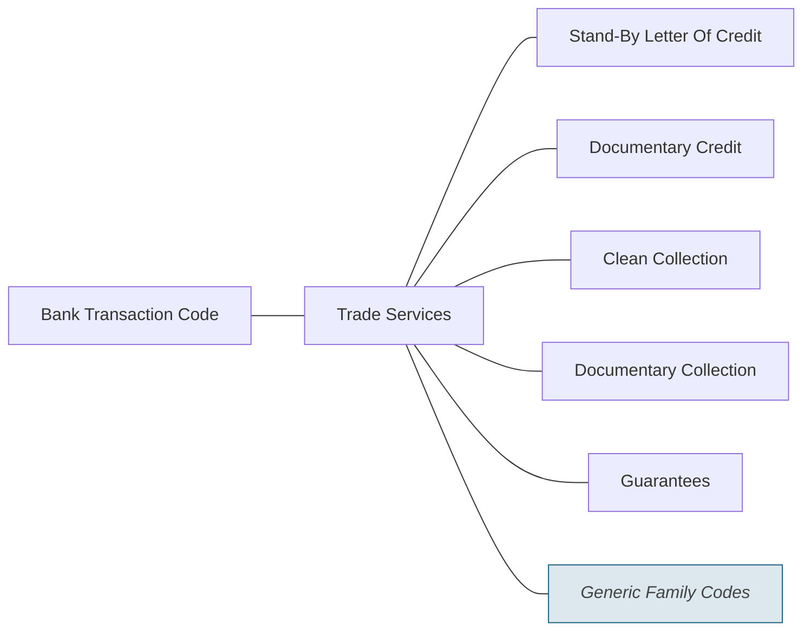

# Trade Services families

Source: [src-000003](../../../../../../../../raw-input/ExternalCodeSets/BTC_ExternalCodeListDescription_Nov2025.docx). direct-body paragraph P268; rendered file/printed page 43.

[Complete rendered source figure (300 dpi)](../../../../../../../assets/src-000003/figure-crops/fig-0010.png) · [Full rendered source page](../../../../../../../assets/src-000003/word-render/page-43.png) · [Mermaid SVG](../../../../../../../assets/src-000003/reconstructed/fig-0010.svg) · [Mermaid preview](../../../../../../../assets/src-000003/reconstructed/fig-0010.png)

Exact SmartArt evidence: [word/diagrams/data7.xml](../smartart/data7.md). All data, drawing, layout, style and color parts are retained.

## Entities and relationships

This is a code taxonomy or data-structure view. It has no business participants, process initiator, message sender/receiver or activity sequence. The publication reporting context is documented separately.

| Source label | Node |
| --- | --- |
| Bank Transaction Code | N1 |
| Trade Services | N2 |
| Stand-By Letter Of Credit | N3 |
| Documentary Credit | N4 |
| Clean Collection | N5 |
| Documentary Collection | N6 |
| Guarantees | N7 |
| Generic Family Codes | N8 |

| Parent/container | Child/member | Source connector evidence |
| --- | --- | --- |
| Bank Transaction Code | Trade Services | /dgm:dataModel/dgm:cxnLst/dgm:cxn[17] |
| Trade Services | Stand-By Letter Of Credit | /dgm:dataModel/dgm:cxnLst/dgm:cxn[3] |
| Trade Services | Documentary Credit | /dgm:dataModel/dgm:cxnLst/dgm:cxn[19] |
| Trade Services | Clean Collection | /dgm:dataModel/dgm:cxnLst/dgm:cxn[21] |
| Trade Services | Documentary Collection | /dgm:dataModel/dgm:cxnLst/dgm:cxn[25] |
| Trade Services | Guarantees | /dgm:dataModel/dgm:cxnLst/dgm:cxn[28] |
| Trade Services | Generic Family Codes | /dgm:dataModel/dgm:cxnLst/dgm:cxn[32] |

## Representation limits

- The source uses connector lines without arrowheads. Mermaid lines represent the displayed taxonomy/structure, not message directions or a time sequence. Layout and box colors differ to keep labels readable; generic-family emphasis is preserved.

## Review evidence

Compared the complete Word-PDF source page and the rendered Mermaid image. Checked each label, parent-child connector, hierarchy boundary and generic-family emphasis. SmartArt source nodes/connections provide exact text and endpoint evidence; no hidden node text is inferred. Completed 2026-11-09. Rendered with Mermaid 12.3.0 and Mermaid browser API + Chromium 156.0.8078.81. Source checksum was verified against the register.
