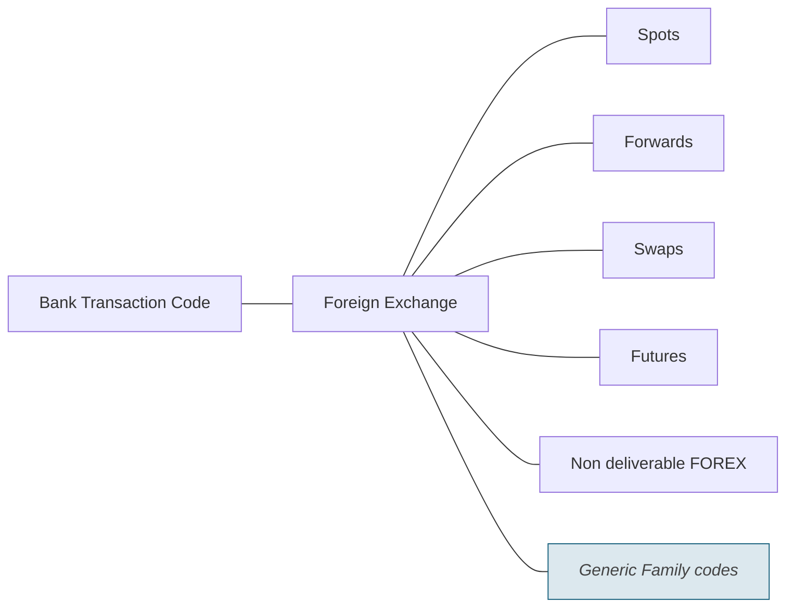

# Foreign Exchange families

Source: [src-000003](../../../../../../../../raw-input/ExternalCodeSets/BTC_ExternalCodeListDescription_Nov2025.docx). direct-body paragraph P321; rendered file/printed page 58.

[Complete rendered source figure (300 dpi)](../../../../../../../assets/src-000003/figure-crops/fig-0013.png) · [Full rendered source page](../../../../../../../assets/src-000003/word-render/page-58.png) · [Mermaid SVG](../../../../../../../assets/src-000003/reconstructed/fig-0013.svg) · [Mermaid preview](../../../../../../../assets/src-000003/reconstructed/fig-0013.png)

Exact SmartArt evidence: [word/diagrams/data10.xml](../smartart/data10.md). All data, drawing, layout, style and color parts are retained.

## Entities and relationships

This is a code taxonomy or data-structure view. It has no business participants, process initiator, message sender/receiver or activity sequence. The publication reporting context is documented separately.

| Source label | Node |
| --- | --- |
| Bank Transaction Code | N1 |
| Foreign Exchange | N2 |
| Spots | N3 |
| Forwards | N4 |
| Swaps | N5 |
| Futures | N6 |
| Non deliverable FOREX | N7 |
| Generic Family codes | N8 |

| Parent/container | Child/member | Source connector evidence |
| --- | --- | --- |
| Bank Transaction Code | Foreign Exchange | /dgm:dataModel/dgm:cxnLst/dgm:cxn[30] |
| Foreign Exchange | Spots | /dgm:dataModel/dgm:cxnLst/dgm:cxn[20] |
| Foreign Exchange | Forwards | /dgm:dataModel/dgm:cxnLst/dgm:cxn[16] |
| Foreign Exchange | Swaps | /dgm:dataModel/dgm:cxnLst/dgm:cxn[29] |
| Foreign Exchange | Futures | /dgm:dataModel/dgm:cxnLst/dgm:cxn[27] |
| Foreign Exchange | Non deliverable FOREX | /dgm:dataModel/dgm:cxnLst/dgm:cxn[7] |
| Foreign Exchange | Generic Family codes | /dgm:dataModel/dgm:cxnLst/dgm:cxn[5] |

## Representation limits

- The source uses connector lines without arrowheads. Mermaid lines represent the displayed taxonomy/structure, not message directions or a time sequence. Layout and box colors differ to keep labels readable; generic-family emphasis is preserved.

## Review evidence

Compared the complete Word-PDF source page and the rendered Mermaid image. Checked each label, parent-child connector, hierarchy boundary and generic-family emphasis. SmartArt source nodes/connections provide exact text and endpoint evidence; no hidden node text is inferred. Completed 2026-11-09. Rendered with Mermaid 12.3.0 and Mermaid browser API + Chromium 156.0.8078.81. Source checksum was verified against the register.
