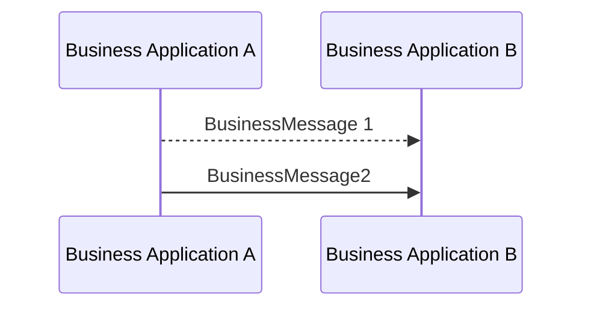

# Original message followed by duplicate

[src-000012](../../../../../../../../raw-input/business_application_header/ISO_20022_BusinessApplicationHeader_MUG_v3_0.pdf), file/printed page 17, §2.8 Duplicate.

[Original extracted artwork](../../../../../../../assets/src-000012/pdf-images/afc06562d5faacebfce99d51ad8edb830c52415a7982068a442c0feedad27e8e.png) · [Complete rendered source page](../../../../../../../assets/src-000012/rendered/page-00017.png) · [Rendered Mermaid SVG](../../../../../../../assets/src-000012/reconstructed/fig-0023.svg) · [Rendered Mermaid PNG](../../../../../../../assets/src-000012/reconstructed/fig-0023.png)

## Reconstruction

## Entities, actors and relationships

Both source arrows go A→B. The earlier message is dashed; the second is solid. §2.8 and its table identify the second as a duplicate using DUPL; that semantic comes from the surrounding source rather than an added arrow label.

## Participant and flow links

- [bah-sending-messaging-endpoint](../../../../../../participants/bah-sending-messaging-endpoint.md).
- [bah-receiving-messaging-endpoint](../../../../../../participants/bah-receiving-messaging-endpoint.md).

- [bah-duplicate](../../../flows/duplicate.md).

## Rendering and visual review

Mermaid 12.3.0 parsed and rendered this reconstruction with Chromium 156.0.8078.81 on 2026-11-09. The source artwork and rendered PNG were visually compared for labels, endpoints, direction, boundaries, choices and visible multiplicity. Raster icons become labelled lifelines or nodes; raster layout is not normative. [Render evidence](../../../../../../../../work/mug-render-report.json).

