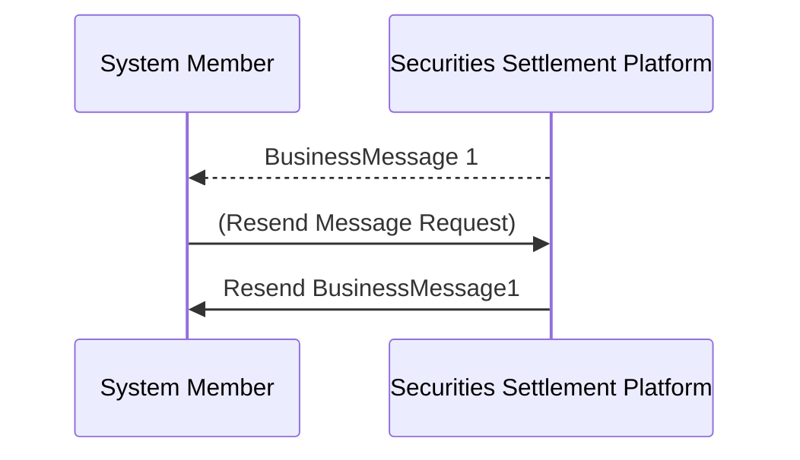

# Requested resend by Securities Settlement Platform

[src-000012](../../../../../../../../raw-input/business_application_header/ISO_20022_BusinessApplicationHeader_MUG_v3_0.pdf), file/printed page 17, §2.8 Requested resend.

[Original extracted artwork](../../../../../../../assets/src-000012/pdf-images/89aef6609f933183b78f11239194af8babccbba79725d3829c38e682afe2a71a.png) · [Complete rendered source page](../../../../../../../assets/src-000012/rendered/page-00017.png) · [Rendered Mermaid SVG](../../../../../../../assets/src-000012/reconstructed/fig-0024.svg) · [Rendered Mermaid PNG](../../../../../../../assets/src-000012/reconstructed/fig-0024.png)

## Reconstruction

## Entities, actors and relationships

The platform sent the original to the member. The member requests a resend, then the platform resends to the member. This is the source example of a requested duplicate; the figure gives no exact schema IDs for these exchanges.

## Participant and flow links

- [bah-sending-messaging-endpoint](../../../../../../participants/bah-sending-messaging-endpoint.md).
- [bah-receiving-messaging-endpoint](../../../../../../participants/bah-receiving-messaging-endpoint.md).

- [bah-duplicate](../../../flows/duplicate.md).

## Rendering and visual review

Mermaid 12.3.0 parsed and rendered this reconstruction with Chromium 156.0.8078.81 on 2026-11-09. The source artwork and rendered PNG were visually compared for labels, endpoints, direction, boundaries, choices and visible multiplicity. Raster icons become labelled lifelines or nodes; raster layout is not normative. [Render evidence](../../../../../../../../work/mug-render-report.json).

