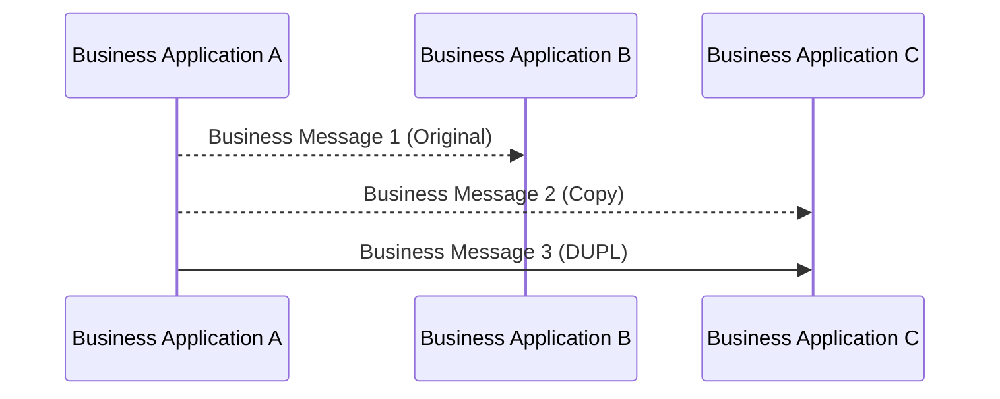

# Duplicate of a previously sent copy

[src-000012](../../../../../../../../raw-input/business_application_header/ISO_20022_BusinessApplicationHeader_MUG_v3_0.pdf), file/printed page 18, §2.9 Duplicate of a copy.

[Original extracted artwork](../../../../../../../assets/src-000012/pdf-images/89e4da87367cf12aedcc222f26542aa301e08b6bc4dd084929a56b3b5d049c79.png) · [Complete rendered source page](../../../../../../../assets/src-000012/rendered/page-00018.png) · [Rendered Mermaid SVG](../../../../../../../assets/src-000012/reconstructed/fig-0025.svg) · [Rendered Mermaid PNG](../../../../../../../assets/src-000012/reconstructed/fig-0025.png)

## Reconstruction

## Entities, actors and relationships

Original message goes to B. The prior copy and its duplicate go to C. The source table uses CODU; the last drawn arrow is labelled DUPL. Both facts are retained, and the source table receiver B conflicts with C in the illustration.

## Participant and flow links

- [bah-sending-messaging-endpoint](../../../../../../participants/bah-sending-messaging-endpoint.md).
- [bah-receiving-messaging-endpoint](../../../../../../participants/bah-receiving-messaging-endpoint.md).

- [bah-duplicate-of-copy](../../../flows/duplicate-of-copy.md).

## Rendering and visual review

Mermaid 12.3.0 parsed and rendered this reconstruction with Chromium 156.0.8078.81 on 2026-11-09. The source artwork and rendered PNG were visually compared for labels, endpoints, direction, boundaries, choices and visible multiplicity. Raster icons become labelled lifelines or nodes; raster layout is not normative. [Render evidence](../../../../../../../../work/mug-render-report.json).

Limitations: Source diagram/table receiver and copy-duplicate label discrepancy: issue-000003. [Issue register](../../../../../../../../tracking/issues.md). A successful faithful reconstruction does not resolve a conflict inside the source.
