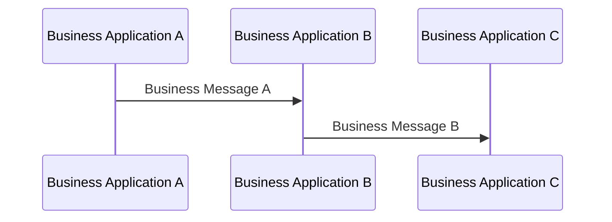

# Related new message through a business intermediary

[src-000012](../../../../../../../../raw-input/business_application_header/ISO_20022_BusinessApplicationHeader_MUG_v3_0.pdf), file/printed page 22, §2.13 Related Business Message.

[Original extracted artwork](../../../../../../../assets/src-000012/pdf-images/81bc373c35e6e94de723fbabb8d34193fce38e997d511c334bbca3a8ab5a53fe.png) · [Complete rendered source page](../../../../../../../assets/src-000012/rendered/page-00022.png) · [Rendered Mermaid SVG](../../../../../../../assets/src-000012/reconstructed/fig-0027.svg) · [Rendered Mermaid PNG](../../../../../../../assets/src-000012/reconstructed/fig-0027.png)

## Reconstruction

## Entities, actors and relationships

The drawn sequence is A→B→C, and Business Message B is different from A. Related carries prior BAH context; CopyDuplicate and PossibleDuplicate are not used. The usage table on the page repeats From A / To B, so this source-direction discrepancy remains explicit.

## Participant and flow links

- [bah-sending-messaging-endpoint](../../../../../../participants/bah-sending-messaging-endpoint.md).
- [bah-receiving-messaging-endpoint](../../../../../../participants/bah-receiving-messaging-endpoint.md).
- [bah-business-intermediary](../../../../../../participants/bah-business-intermediary.md).

- [bah-related-message](../../../flows/related-message.md).

## Rendering and visual review

Mermaid 12.3.0 parsed and rendered this reconstruction with Chromium 156.0.8078.81 on 2026-11-09. The source artwork and rendered PNG were visually compared for labels, endpoints, direction, boundaries, choices and visible multiplicity. Raster icons become labelled lifelines or nodes; raster layout is not normative. [Render evidence](../../../../../../../../work/mug-render-report.json).

Limitations: Source diagram/table direction discrepancy: issue-000003. [Issue register](../../../../../../../../tracking/issues.md). A successful faithful reconstruction does not resolve a conflict inside the source.
