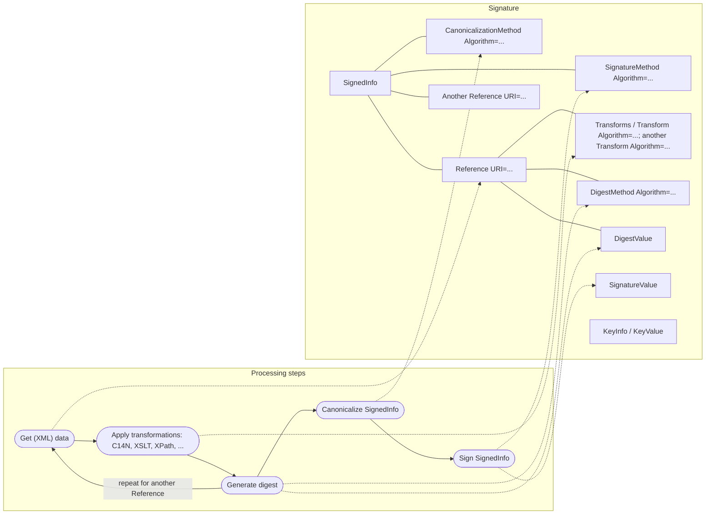

# XML Signature elements mapped to processing steps

[src-000012](../../../../../../../../raw-input/business_application_header/ISO_20022_BusinessApplicationHeader_MUG_v3_0.pdf), file/printed page 30, §4.2.2, Figure 3 XML Signature elements.

[Original extracted artwork](../../../../../../../assets/src-000012/pdf-images/a05bd9e0e94116b8fc7b0c9320f4a8cbb763ee3e192046eb121ceef8669a3a61.png) · [Complete rendered source page](../../../../../../../assets/src-000012/rendered/page-00030.png) · [Rendered Mermaid SVG](../../../../../../../assets/src-000012/reconstructed/fig-0032.svg) · [Rendered Mermaid PNG](../../../../../../../assets/src-000012/reconstructed/fig-0032.png)

## Reconstruction

## Entities, actors and relationships

The red process path iterates get-data, transform and digest for references, then canonicalizes and signs SignedInfo. Grey source mapping arrows connect data selection to Reference URI, transforms to Transform entries, digest generation to DigestMethod and DigestValue, canonicalization to CanonicalizationMethod, and signing to SignatureMethod and SignatureValue. The shown Signature also contains KeyInfo/KeyValue. XML attribute placeholders and sample digest/signature bytes remain in the original artwork; the graph labels describe XML locations, not executable XML.

## Participant and flow links

- [bah-sending-messaging-endpoint](../../../../../../participants/bah-sending-messaging-endpoint.md).
- [bah-receiving-messaging-endpoint](../../../../../../participants/bah-receiving-messaging-endpoint.md).
- [bah-authorised-signatory](../../../../../../participants/bah-authorised-signatory.md).
- [bah-signature-verifier](../../../../../../participants/bah-signature-verifier.md).

- [bah-signed-message](../../../flows/signed-message.md).

## Rendering and visual review

Mermaid 12.3.0 parsed and rendered this reconstruction with Chromium 156.0.8078.81 on 2026-11-09. The source artwork and rendered PNG were visually compared for labels, endpoints, direction, boundaries, choices and visible multiplicity. Raster icons become labelled lifelines or nodes; raster layout is not normative. [Render evidence](../../../../../../../../work/mug-render-report.json).

