# A2A communication, inbound and outbound processing

[src-000343](../../../../../../../raw-input/target2securities_t2s/ISO20022_MDR_Target2Securities_August_2026_v1.zip) archive member `ISO20022_MDR_Target2Securities_August_2026_v1/Target2-Securities_Administration_MessageSet/ISO20022_MDRPart1_Target2Securities_Administration_2023_2024_v2.docx`; direct-body paragraph P142; Word file page 19.

[Original complete figure](../../../../../../assets/src-000343/originals/image6.emf) · [Readable original](../../../../../../assets/src-000343/derived-previews/image6.emf.png) · [Business flow and participant responsibilities](../../flows/flow-src-000343-p142-technical-processing.md)

## Linked module views

- [Communication Module - A2A](fig-0006-communication.md)
- [Inbound Processing Module – A2A](fig-0006-inbound.md)
- [Outbound Processing Module – A2A](fig-0006-outbound.md)

## Source reconstruction

```mermaid
flowchart TB
subgraph group0["T2S System User"]
uSend(["A2A"])
uAckReceive(["A2A"])
uAckSend(["A2A"])
uReceive(["A2A"])
end
subgraph group1["Communication Module - A2A"]
encIn["Encrypted inbound communication A2A"]
recv(["1 - Receive/Log Communication A2A"])
recvFork@{ shape: fork }
techAckOut["Technical Acknowledgement"]
auth(["2 - Check Sender Authentication and Decryption A2A"])
authD{"#160;"}
store(["3 - Store Communication Content A2A"])
storeD{"#160;"}
storedMessage["Stored inbound communication - A2A individual message"]
storedFile["Stored inbound communication - A2A file"]
formatted["Formatted outbound communication A2A"]
queueMerge{"#160;"}
outCheck(["4 - Check for A2A Outbound Queuing"])
outQueueD{"#160;"}
outQueue(["5 - Queue A2A Outbound Communication"])
restart(["6 - Restart Queued A2A Outbound Communication"])
extBar@{ shape: fork }
extMerge{"#160;"}
sendMerge{"#160;"}
cert(["7 - Assign Certificate and Encryption A2A"])
techAckIn["Technical Acknowledgement"]
transmitMerge{"#160;"}
transmit(["8 - Transmit Communication A2A"])
encOut["Encrypted outbound communication A2A"]
end
subgraph group2["Inbound Processing Module – A2A"]
file(["1 - A2A File Validation and Splitting"])
fileD{"#160;"}
msgMerge{"#160;"}
schema(["2 - A2A Message Schema Validation"])
schemaD{"#160;"}
parse(["3 - A2A Message Parsing"])
parseD{"#160;"}
priv(["4 - Check Privilege"])
privD{"#160;"}
queueStartMerge{"#160;"}
queueEventsMerge{"#160;"}
queueEndBar@{ shape: fork }
inCheck(["5 - Check for A2A Inbound Queuing"])
inQueueD{"#160;"}
queryD{"#160;"}
queryFork@{ shape: fork }
queueMergeIn{"#160;"}
inQueue(["6 - Queue A2A Inbound Message"])
inRestart(["7 - Restart Queued A2A Inbound Messages"])
routeMerge{"#160;"}
router(["8 - Information Router"])
routeD{"#160;"}
permission(["9 - Check Permission - Resend"])
permissionD{"#160;"}
permissionFork@{ shape: fork }
fileReject["Inbound processing rejection – A2A File"]
schemaReject["Inbound processing rejection – A2A Schema"]
parseReject["Inbound processing rejection – A2A Additional technical validation"]
privReject["Inbound processing rejection – Privilege"]
queryReject["Inbound processing rejection – Query Queuing"]
permissionReject["Inbound processing rejection - Permission"]
resendResult["Validation result - resend"]
resend["Resend communication"]
businessIn["Inbound business data"]
rejectMerge1{"#160;"}
rejectMerge2{"#160;"}
rejectMerge3{"#160;"}
rejectMerge4{"#160;"}
rejectMerge5{"#160;"}
rejectMerge6{"#160;"}
rejectMerge7{"#160;"}
end
subgraph group3["Outbound Processing Module – A2A"]
businessOut["Outbound business data"]
resendOther["Resend communication"]
originMerge{"#160;"}
statusMerge{"#160;"}
log(["1 - Logging Outbound Business Data"])
recipient(["2 - Define Possible Recipient List A2A"])
subscription(["3 - Check A2A Message Subscription"])
payload(["4 - Create Business Payload A2A"])
routing(["5 - Prepare Routing A2A"])
sequence(["6 - A2A Message Sequencing"])
create(["7 - Create A2A Outbound Communication"])
end
subgraph group4["Adjacent modules and system events"]
schedOut(["OPSR: Scheduling"])
schedOutD{"#160;"}
available["External system available event"]
unavailable["External system unavailable event"]
schedIn(["OPSR: Scheduling"])
schedInD{"#160;"}
startQueue["Start Queueing System status events"]
endQueue["End Queueing – System Status events"]
backIn(["Backend Modules"])
backOut(["Backend Modules"])
u2a(["INTF: Inbound Processing Module - U2A"])
end
uSend --> encIn
encIn --> recv
recv --> recvFork
recvFork --> auth
auth --> authD
recvFork --> techAckOut
techAckOut --> uAckReceive
authD -->|"Not authenticated"| sendMerge
authD -->|"Authenticated"| store
store --> storeD
storeD -->|"Message received"| storedMessage
storeD -->|"File received"| storedFile
storedFile --> file
file --> fileD
fileD -->|"File not ok or file duplicate check not ok"| fileReject
fileD -->|"File ok"| msgMerge
storedMessage --> msgMerge
msgMerge --> schema
schema --> schemaD
schemaD -->|"Schema validation not ok"| schemaReject
schemaD -->|"Schema validation ok"| parse
parse --> parseD
parseD -->|"Additional technical Validation or duplicate check not ok"| parseReject
parseD -->|"Additional technical validation or duplicate check ok"| priv
priv --> privD
privD -->|"Privilege not ok"| privReject
privD -->|"Privilege ok"| queueStartMerge
queueStartMerge --> inCheck
inCheck --> inQueueD
inQueueD -->|"Not queued"| routeMerge
inQueueD -->|"Queued"| queryD
queryD -->|"Query"| queryFork
queryD -->|"No Query"| queueMergeIn
queryFork --> queryReject
queryFork --> queueMergeIn
queueMergeIn --> inQueue
schedIn --> schedInD
schedInD --> startQueue
schedInD --> endQueue
startQueue --> queueEventsMerge
endQueue --> queueEndBar
queueEndBar --> queueEventsMerge
queueEndBar --> inRestart
queueEventsMerge --> queueStartMerge
inRestart --> routeMerge
routeMerge --> router
router --> routeD
routeD -->|"any request except Resend Communication"| businessIn
businessIn --> backIn
routeD -->|"Resend Communication"| permission
permission --> permissionD
permissionD -->|"Permission not ok"| permissionReject
permissionD -->|"Permission ok"| permissionFork
permissionFork --> resendResult
permissionFork --> resend
fileReject --> rejectMerge1
schemaReject --> rejectMerge1
rejectMerge1 --> rejectMerge2
parseReject --> rejectMerge2
rejectMerge2 --> rejectMerge3
privReject --> rejectMerge3
rejectMerge3 --> rejectMerge4
queryReject --> rejectMerge4
rejectMerge4 --> rejectMerge5
permissionReject --> rejectMerge5
rejectMerge5 --> rejectMerge6
resendResult --> rejectMerge6
rejectMerge6 --> rejectMerge7
resend --> rejectMerge7
rejectMerge7 --> statusMerge
backOut --> businessOut
businessOut --> originMerge
u2a --> resendOther
resendOther --> originMerge
originMerge --> statusMerge
statusMerge --> log
log --> recipient
recipient --> subscription
subscription --> payload
payload --> routing
routing --> sequence
sequence --> create
create --> formatted
formatted --> queueMerge
queueMerge --> outCheck
outCheck --> outQueueD
outQueueD -->|"Outbound Queuing"| outQueue
outQueueD -->|"No Outbound Queuing"| sendMerge
schedOut --> schedOutD
schedOutD --> available
schedOutD --> unavailable
available --> extBar
unavailable --> extMerge
extBar --> extMerge
extBar --> restart
extMerge --> queueMerge
restart --> sendMerge
sendMerge --> cert
cert --> transmitMerge
transmitMerge --> transmit
transmit --> encOut
encOut --> uReceive
uAckSend --> techAckIn
techAckIn --> transmitMerge
style extBar fill:#222,stroke:#222
style permissionFork fill:#222,stroke:#222
style queryFork fill:#222,stroke:#222
style queueEndBar fill:#222,stroke:#222
style recvFork fill:#222,stroke:#222
```

## Entities and connections

| Source node | Destination node | Source condition |
| --- | --- | --- |
| uSend — A2A | encIn — Encrypted inbound communication A2A | Unlabelled directed connector |
| encIn — Encrypted inbound communication A2A | recv — 1 - Receive/Log Communication A2A | Unlabelled directed connector |
| recv — 1 - Receive/Log Communication A2A | recvFork —  | Unlabelled directed connector |
| recvFork —  | auth — 2 - Check Sender Authentication and Decryption A2A | Unlabelled directed connector |
| auth — 2 - Check Sender Authentication and Decryption A2A | authD —  | Unlabelled directed connector |
| recvFork —  | techAckOut — Technical Acknowledgement | Unlabelled directed connector |
| techAckOut — Technical Acknowledgement | uAckReceive — A2A | Unlabelled directed connector |
| authD —  | sendMerge —  | Not authenticated |
| authD —  | store — 3 - Store Communication Content A2A | Authenticated |
| store — 3 - Store Communication Content A2A | storeD —  | Unlabelled directed connector |
| storeD —  | storedMessage — Stored inbound communication - A2A individual message | Message received |
| storeD —  | storedFile — Stored inbound communication - A2A file | File received |
| storedFile — Stored inbound communication - A2A file | file — 1 - A2A File Validation and Splitting | Unlabelled directed connector |
| file — 1 - A2A File Validation and Splitting | fileD —  | Unlabelled directed connector |
| fileD —  | fileReject — Inbound processing rejection – A2A File | File not ok or file duplicate check not ok |
| fileD —  | msgMerge —  | File ok |
| storedMessage — Stored inbound communication - A2A individual message | msgMerge —  | Unlabelled directed connector |
| msgMerge —  | schema — 2 - A2A Message Schema Validation | Unlabelled directed connector |
| schema — 2 - A2A Message Schema Validation | schemaD —  | Unlabelled directed connector |
| schemaD —  | schemaReject — Inbound processing rejection – A2A Schema | Schema validation not ok |
| schemaD —  | parse — 3 - A2A Message Parsing | Schema validation ok |
| parse — 3 - A2A Message Parsing | parseD —  | Unlabelled directed connector |
| parseD —  | parseReject — Inbound processing rejection – A2A Additional technical validation | Additional technical Validation or duplicate check not ok |
| parseD —  | priv — 4 - Check Privilege | Additional technical validation or duplicate check ok |
| priv — 4 - Check Privilege | privD —  | Unlabelled directed connector |
| privD —  | privReject — Inbound processing rejection – Privilege | Privilege not ok |
| privD —  | queueStartMerge —  | Privilege ok |
| queueStartMerge —  | inCheck — 5 - Check for A2A Inbound Queuing | Unlabelled directed connector |
| inCheck — 5 - Check for A2A Inbound Queuing | inQueueD —  | Unlabelled directed connector |
| inQueueD —  | routeMerge —  | Not queued |
| inQueueD —  | queryD —  | Queued |
| queryD —  | queryFork —  | Query |
| queryD —  | queueMergeIn —  | No Query |
| queryFork —  | queryReject — Inbound processing rejection – Query Queuing | Unlabelled directed connector |
| queryFork —  | queueMergeIn —  | Unlabelled directed connector |
| queueMergeIn —  | inQueue — 6 - Queue A2A Inbound Message | Unlabelled directed connector |
| schedIn — OPSR: Scheduling | schedInD —  | Unlabelled directed connector |
| schedInD —  | startQueue — Start Queueing System status events | Unlabelled directed connector |
| schedInD —  | endQueue — End Queueing – System Status events | Unlabelled directed connector |
| startQueue — Start Queueing System status events | queueEventsMerge —  | Unlabelled directed connector |
| endQueue — End Queueing – System Status events | queueEndBar —  | Unlabelled directed connector |
| queueEndBar —  | queueEventsMerge —  | Unlabelled directed connector |
| queueEndBar —  | inRestart — 7 - Restart Queued A2A Inbound Messages | Unlabelled directed connector |
| queueEventsMerge —  | queueStartMerge —  | Unlabelled directed connector |
| inRestart — 7 - Restart Queued A2A Inbound Messages | routeMerge —  | Unlabelled directed connector |
| routeMerge —  | router — 8 - Information Router | Unlabelled directed connector |
| router — 8 - Information Router | routeD —  | Unlabelled directed connector |
| routeD —  | businessIn — Inbound business data | any request except Resend Communication |
| businessIn — Inbound business data | backIn — Backend Modules | Unlabelled directed connector |
| routeD —  | permission — 9 - Check Permission - Resend | Resend Communication |
| permission — 9 - Check Permission - Resend | permissionD —  | Unlabelled directed connector |
| permissionD —  | permissionReject — Inbound processing rejection - Permission | Permission not ok |
| permissionD —  | permissionFork —  | Permission ok |
| permissionFork —  | resendResult — Validation result - resend | Unlabelled directed connector |
| permissionFork —  | resend — Resend communication | Unlabelled directed connector |
| fileReject — Inbound processing rejection – A2A File | rejectMerge1 —  | Unlabelled directed connector |
| schemaReject — Inbound processing rejection – A2A Schema | rejectMerge1 —  | Unlabelled directed connector |
| rejectMerge1 —  | rejectMerge2 —  | Unlabelled directed connector |
| parseReject — Inbound processing rejection – A2A Additional technical validation | rejectMerge2 —  | Unlabelled directed connector |
| rejectMerge2 —  | rejectMerge3 —  | Unlabelled directed connector |
| privReject — Inbound processing rejection – Privilege | rejectMerge3 —  | Unlabelled directed connector |
| rejectMerge3 —  | rejectMerge4 —  | Unlabelled directed connector |
| queryReject — Inbound processing rejection – Query Queuing | rejectMerge4 —  | Unlabelled directed connector |
| rejectMerge4 —  | rejectMerge5 —  | Unlabelled directed connector |
| permissionReject — Inbound processing rejection - Permission | rejectMerge5 —  | Unlabelled directed connector |
| rejectMerge5 —  | rejectMerge6 —  | Unlabelled directed connector |
| resendResult — Validation result - resend | rejectMerge6 —  | Unlabelled directed connector |
| rejectMerge6 —  | rejectMerge7 —  | Unlabelled directed connector |
| resend — Resend communication | rejectMerge7 —  | Unlabelled directed connector |
| rejectMerge7 —  | statusMerge —  | Unlabelled directed connector |
| backOut — Backend Modules | businessOut — Outbound business data | Unlabelled directed connector |
| businessOut — Outbound business data | originMerge —  | Unlabelled directed connector |
| u2a — INTF: Inbound Processing Module - U2A | resendOther — Resend communication | Unlabelled directed connector |
| resendOther — Resend communication | originMerge —  | Unlabelled directed connector |
| originMerge —  | statusMerge —  | Unlabelled directed connector |
| statusMerge —  | log — 1 - Logging Outbound Business Data | Unlabelled directed connector |
| log — 1 - Logging Outbound Business Data | recipient — 2 - Define Possible Recipient List A2A | Unlabelled directed connector |
| recipient — 2 - Define Possible Recipient List A2A | subscription — 3 - Check A2A Message Subscription | Unlabelled directed connector |
| subscription — 3 - Check A2A Message Subscription | payload — 4 - Create Business Payload A2A | Unlabelled directed connector |
| payload — 4 - Create Business Payload A2A | routing — 5 - Prepare Routing A2A | Unlabelled directed connector |
| routing — 5 - Prepare Routing A2A | sequence — 6 - A2A Message Sequencing | Unlabelled directed connector |
| sequence — 6 - A2A Message Sequencing | create — 7 - Create A2A Outbound Communication | Unlabelled directed connector |
| create — 7 - Create A2A Outbound Communication | formatted — Formatted outbound communication A2A | Unlabelled directed connector |
| formatted — Formatted outbound communication A2A | queueMerge —  | Unlabelled directed connector |
| queueMerge —  | outCheck — 4 - Check for A2A Outbound Queuing | Unlabelled directed connector |
| outCheck — 4 - Check for A2A Outbound Queuing | outQueueD —  | Unlabelled directed connector |
| outQueueD —  | outQueue — 5 - Queue A2A Outbound Communication | Outbound Queuing |
| outQueueD —  | sendMerge —  | No Outbound Queuing |
| schedOut — OPSR: Scheduling | schedOutD —  | Unlabelled directed connector |
| schedOutD —  | available — External system available event | Unlabelled directed connector |
| schedOutD —  | unavailable — External system unavailable event | Unlabelled directed connector |
| available — External system available event | extBar —  | Unlabelled directed connector |
| unavailable — External system unavailable event | extMerge —  | Unlabelled directed connector |
| extBar —  | extMerge —  | Unlabelled directed connector |
| extBar —  | restart — 6 - Restart Queued A2A Outbound Communication | Unlabelled directed connector |
| extMerge —  | queueMerge —  | Unlabelled directed connector |
| restart — 6 - Restart Queued A2A Outbound Communication | sendMerge —  | Unlabelled directed connector |
| sendMerge —  | cert — 7 - Assign Certificate and Encryption A2A | Unlabelled directed connector |
| cert — 7 - Assign Certificate and Encryption A2A | transmitMerge —  | Unlabelled directed connector |
| transmitMerge —  | transmit — 8 - Transmit Communication A2A | Unlabelled directed connector |
| transmit — 8 - Transmit Communication A2A | encOut — Encrypted outbound communication A2A | Unlabelled directed connector |
| encOut — Encrypted outbound communication A2A | uReceive — A2A | Unlabelled directed connector |
| uAckSend — A2A | techAckIn — Technical Acknowledgement | Unlabelled directed connector |
| techAckIn — Technical Acknowledgement | transmitMerge —  | Unlabelled directed connector |

## Source qualifications

- The four A2A ovals in the T2S System User region are retained as separate occurrences: inbound communication, receiving technical acknowledgement, sending technical acknowledgement and receiving outbound communication.
- Technical acknowledgements, authentication failure and processing rejection paths are distinct. A technical acknowledgement is not a business-success claim.
- The source has no outgoing connector from Queue A2A Outbound Communication (step5) or Queue A2A Inbound Message (step6). Their restart activities are independently connected through system events; no missing queue-to-restart arrow is invented.
- Every rejection feeds the drawn right-hand merge chain before outbound processing. Query queuing has a fork: rejection output and queuing path are both retained.
- System-event diamonds/bars and the blank merge diamonds are transcribed as drawn. The underlined source labels denote state/data objects; no storage schema or ownership is inferred.
- Details split the single source artwork by module. Boundary nodes repeat only to keep every cross-module connector visible; matching node identifiers denote the same source occurrence.

## Rendering and visual review

Mermaid 12.3.0 with Mermaid browser API + Chromium 156.0.8078.81 parsed and rendered this view. On 2026-11-09, the original artwork and final reconstruction were directly compared for labels, modules, participants, every endpoint and direction, guards, forks/merges, alternative frames and the distinction between technical and business outcomes. **Visible-source fidelity: pass.** Source conflicts remain open where listed. Layout, arrowhead styling and underlined data-box typography differ; the original and explicit descriptions remain available. Hidden native content is a separate review scope.

[Rendered SVG](../../../../../../assets/src-000343/reconstructed-modules/fig-0006.svg) · [Rendered PNG](../../../../../../assets/src-000343/reconstructed-modules/fig-0006.png) · [Hash-bound review evidence](../../../../../../../tracking/reviews/t2s-administration-diagrams.json)
