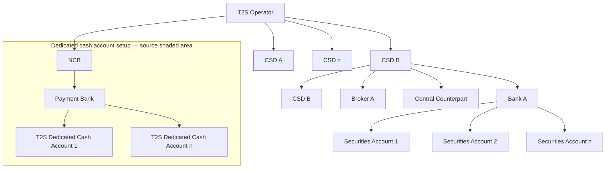

# T2S role and access-right hierarchy

[src-000343](../../../../../../../raw-input/target2securities_t2s/ISO20022_MDR_Target2Securities_August_2026_v1.zip) archive member `ISO20022_MDR_Target2Securities_August_2026_v1/Target2-Securities_Administration_MessageSet/ISO20022_MDRPart1_Target2Securities_Administration_2023_2024_v2.docx`; direct-body paragraph P101; BusinessRoles and Participants; additional Word-rendered file page 9 (exact binary asset match).

[Original figure](../../../../../../assets/src-000343/originals/image1.wmf) · [Readable preview](../../../../../../assets/src-000343/derived-previews/image1.wmf.png)

## Source reconstruction

## Participants and context

- [T2S operator](../../../../../participants/participant-src-000343-t2s-operator.md)
- [Central Securities Depositories (CSD)](../../../../../participants/participant-src-000343-central-securities-depositories-csd.md)
- [National Central Bank (NCB)](../../../../../participants/participant-src-000343-national-central-bank-ncb.md)
- [Payment Bank](../../../../../participants/participant-src-000343-payment-bank.md)
- [Bank A](../../../../../participants/participant-src-000343-illustrative-bank.md)
- [Broker A](../../../../../participants/participant-src-000343-illustrative-broker.md)
- [Central Counterpart](../../../../../participants/participant-src-000343-central-counterpart.md)

## Relationships and directed exchanges

| Source / endpoint1 | Destination / endpoint2 | Condition, exchange or connector |
| --- | --- | --- |
| T2S Operator | CSD A | Unlabelled directed path |
| T2S Operator | CSD B | Unlabelled directed path |
| T2S Operator | CSD n | Unlabelled directed path |
| T2S Operator | NCB | Unlabelled directed path |
| CSD B | CSD B | Unlabelled directed path |
| CSD B | Bank A | Unlabelled directed path |
| CSD B | Broker A | Unlabelled directed path |
| CSD B | Central Counterpart | Unlabelled directed path |
| NCB | Payment Bank | Unlabelled directed path |
| Bank A | Securities Account 1 | Unlabelled directed path |
| Bank A | Securities Account 2 | Unlabelled directed path |
| Bank A | Securities Account n | Unlabelled directed path |
| Payment Bank | T2S Dedicated Cash Account 1 | Unlabelled directed path |
| Payment Bank | T2S Dedicated Cash Account n | Unlabelled directed path |

## Qualifications

- Source levels: Level1 T2S Operator; Level2 CSD A/CSD B/CSD n/NCB; Level3 CSD B/Bank A/Broker A/Central Counterpart/Payment Bank; Level4 securities and dedicated cash accounts. The repeated CSD B is two separate node occurrences.
- Source ellipses indicate additional CSDs, actors and accounts; no unshown instances are invented. The grey region is dedicated-cash-account static-data setup (P103), not an ownership or database-key inference.
- P100 calls this Collateral Reporting despite the Administration publication scope; issue-000039. P103 explicitly says an NCB can act as both NCB and CSD; the roles remain separate.

## Rendering and visual review

Mermaid 12.3.0 with Mermaid browser API + Chromium 156.0.8078.81 parsed and rendered this view. On 2026-11-09, the original artwork and final reconstruction were directly compared for labels, modules, participants, every endpoint and direction, guards, forks/merges, alternative frames and the distinction between technical and business outcomes. **Visible-source fidelity: pass.** Source conflicts remain open where listed. Layout, arrowhead styling and underlined data-box typography differ; the original and explicit descriptions remain available. Hidden native content is a separate review scope.

[Rendered SVG](../../../../../../assets/src-000343/reconstructed-administration/fig-0001.svg) · [Rendered PNG](../../../../../../assets/src-000343/reconstructed-administration/fig-0001.png) · [Hash-bound review evidence](../../../../../../../tracking/reviews/t2s-administration-diagrams.json)
