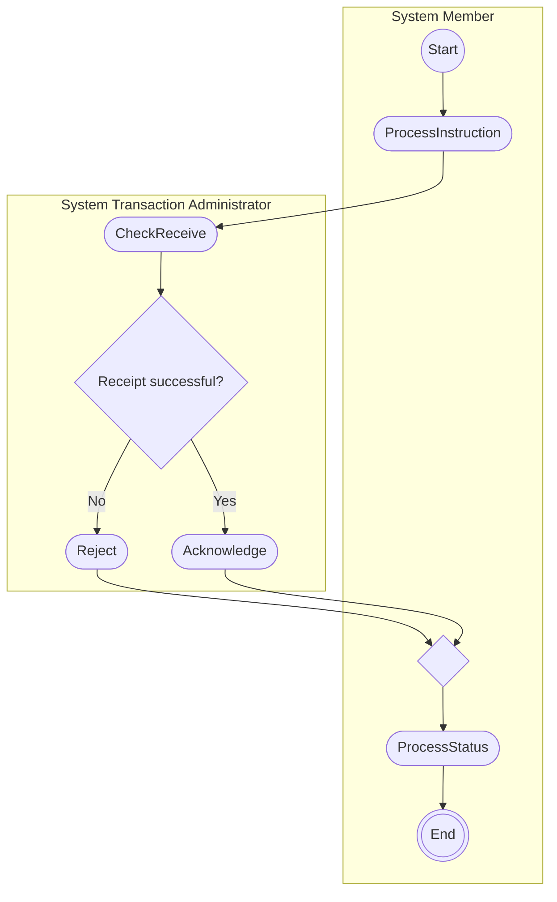

# Receipt acknowledgement activity — Scenario1a

[src-000343](../../../../../../../raw-input/target2securities_t2s/ISO20022_MDR_Target2Securities_August_2026_v1.zip) archive member `ISO20022_MDR_Target2Securities_August_2026_v1/Target2-Securities_Administration_MessageSet/ISO20022_MDRPart1_Target2Securities_Administration_2023_2024_v2.docx`; direct-body paragraph P164; Description of BusinessActivities / Receipt Acknowledgement (admi.007) / Scenario 1a; additional Word-rendered file page 26 (exact binary asset match).

[Original figure](../../../../../../assets/src-000343/originals/image13.emf) · [Readable preview](../../../../../../assets/src-000343/derived-previews/image13.emf.png) · [Business flow](../../flows/flow-src-000343-p162-scenario-1a.md)

## Source reconstruction

## Participants and context

- [System Member](../../../../../participants/participant-src-000343-system-member.md)
- [System Transaction Administrator](../../../../../participants/participant-src-000343-system-transaction-administrator.md)

## Relationships and directed exchanges

| Source / endpoint1 | Destination / endpoint2 | Condition, exchange or connector |
| --- | --- | --- |
| start | ProcessInstruction | Unlabelled directed path |
| ProcessInstruction | CheckReceive | Unlabelled directed path |
| CheckReceive | Receipt successful? | Unlabelled directed path |
| Receipt successful? | Reject | No |
| ProcessStatus | endSM | Unlabelled directed path |
| Receipt successful? | Acknowledge | Yes |
| Reject | merge | Unlabelled directed path |
| Acknowledge | merge | Unlabelled directed path |
| merge | ProcessStatus | Unlabelled directed path |

## Qualifications

- Scenario1a sends rejection or positive receipt acknowledgement. Scenario1b sends a negative business-processing response only on failure and continues processing on success. These are alternative source scenarios, not a combined mandatory exchange.

## Rendering and visual review

Mermaid 12.3.0 with Mermaid browser API + Chromium 156.0.8078.81 parsed and rendered this view. On 2026-11-09, the original artwork and final reconstruction were directly compared for labels, modules, participants, every endpoint and direction, guards, forks/merges, alternative frames and the distinction between technical and business outcomes. **Visible-source fidelity: pass.** Source conflicts remain open where listed. Layout, arrowhead styling and underlined data-box typography differ; the original and explicit descriptions remain available. Hidden native content is a separate review scope.

[Rendered SVG](../../../../../../assets/src-000343/reconstructed-administration/fig-0013.svg) · [Rendered PNG](../../../../../../assets/src-000343/reconstructed-administration/fig-0013.png) · [Hash-bound review evidence](../../../../../../../tracking/reviews/t2s-administration-diagrams.json)
